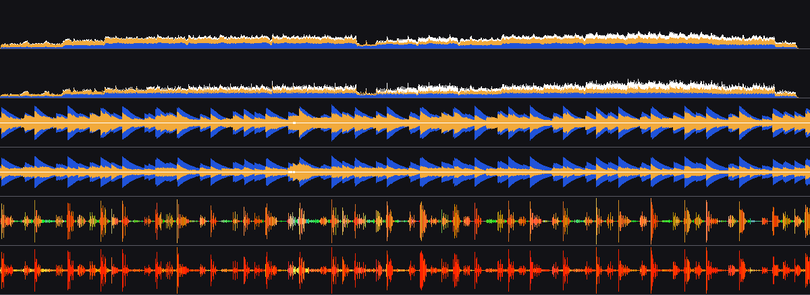
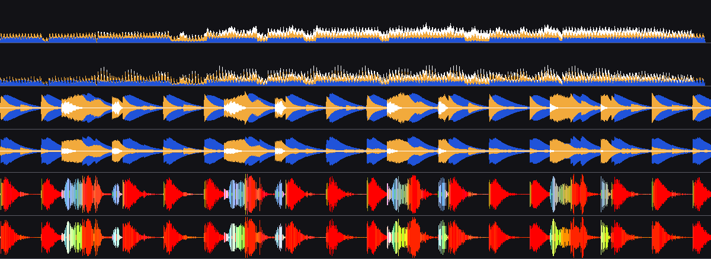
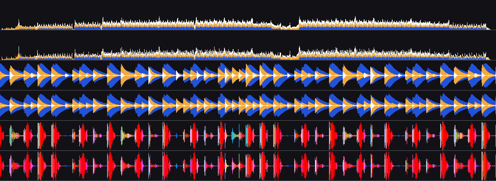
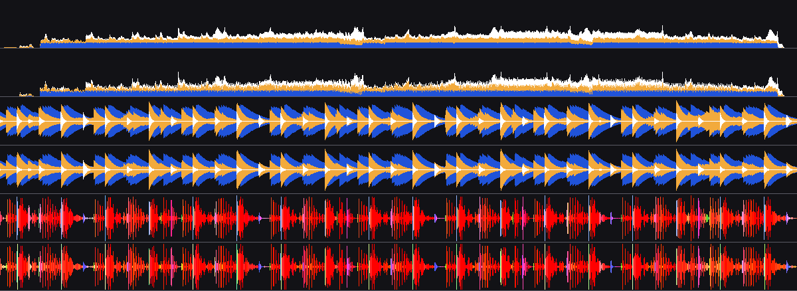
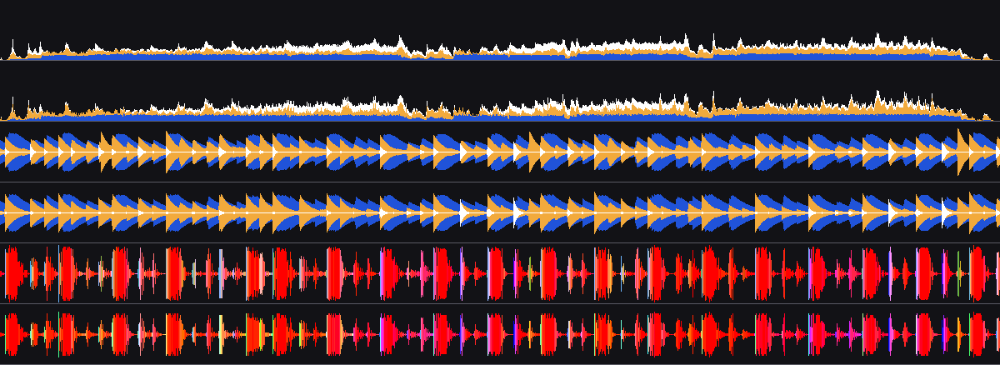
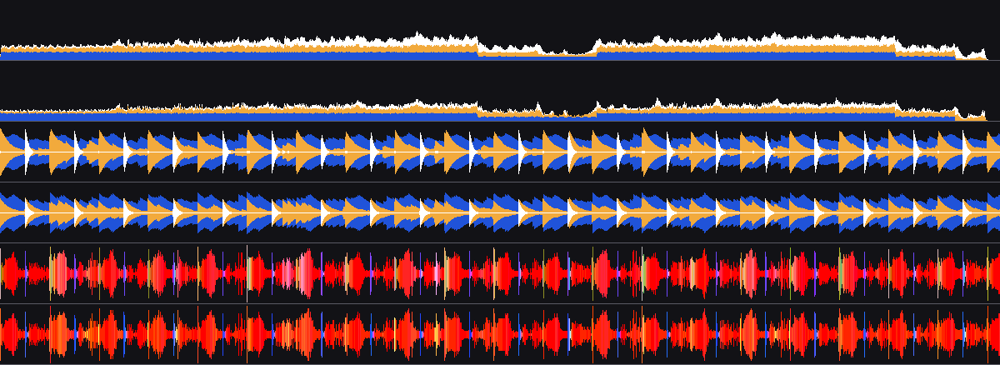
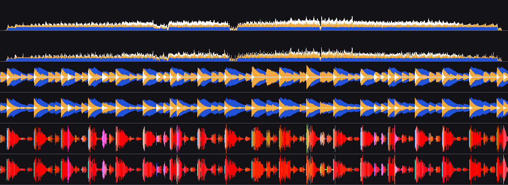
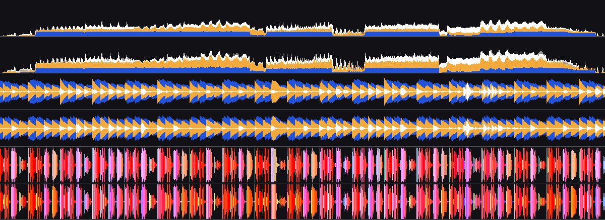

# Waveform calibration against rekordbox

Phase 3 task 8, 2026-10-20. How reks's waveform columns
([`reks-analysis::waveform`](../../crates/reks-analysis/src/waveform.rs)) become
Pioneer waveform bytes, fitted against rekordbox 6's own analysis. Constants:
[`reks-analysis::calib`](../../crates/reks-analysis/src/calib.rs). Encoders:
[`reks-anlz::waveform`](../../crates/reks-anlz/src/waveform.rs). Visual parity
on a player is **UNVERIFIED** (phase 3 task 14).

## Set

50 tracks from the maintainer's library that rekordbox 6 had analysed, read
from its local cache (`~/Library/Pioneer/rekordbox/share/PIONEER/USBANLZ`,
read only). The cache's PPTH holds only `?/<file name>`, so tracks are
matched by NFC file name against the music folder (2,601 unique matches);
names that occur twice are skipped. Picked per genre tag bucket (at least
3 each, the rest by share) and, within a bucket, evenly over loudness
(rekordbox's mean PWV3 height, 3.5–16.7): untagged 24, electro 7,
psytrance 4, ambient/house/other/techno/trance 3 each; 42 FLAC, 6 MP3,
2 WAV; three at 48 kHz.

## Method

- Ours: the analysis pipeline's columns (decode, mono, 44.1 kHz, Bessel-4
  bands at 600 Hz / 4 kHz, per-column peaks), encoded with a candidate
  calibration.
- Alignment: rekordbox's detail columns (PWV3/PWV5/PWV7) are shifted by the
  lag that best correlates its PWV3 heights with our mono peaks. FLAC and
  WAV: 0. MP3: 4 or 8 columns (≈ 27/53 ms, its decoder-delay convention;
  input to task 4).
- Error: [`compare.rs`](../../crates/reks-anlz/src/compare.rs), per channel
  the mean absolute difference over the shared columns divided by full
  scale (bit fields: their maximum; bytes: the larger of both files'
  maxima), averaged over tracks.
- Fit: coordinate descent over 40 numbers (gains, gammas, weights, release,
  track-gain targets), each chosen by its section's mean error, 4 rounds
  with a shrinking search span. Reproduce (prints errors and the constants
  as Rust, draws the pictures):

  ```sh
  REKS_RB_ANLZ=~/Library/Pioneer/rekordbox/share/PIONEER/USBANLZ \
  REKS_CALIB_MUSIC=~/Music/play REKS_CALIB_PNG="$PWD/docs/analysis-parity" \
  cargo test --release -p reks-anlz --test calibrate -- --ignored --nocapture
  ```

  About 12 minutes on 14 cores. [`tests/calibrate.rs`](../../crates/reks-anlz/tests/calibrate.rs).

## Model

`curve(x) = clamp(gain·x, 0, 1)^gamma`, `x` in 0..1. Bands are low, mid,
high.

| Section | Model |
|---|---|
| PWV3 height, PWV5 height | 31 × curve(mono peak), gamma ≈ 2.1 (rekordbox's height is close to peak power) |
| PWV3 / PWAV whiteness | 7 × curve(weighted mid+high share of band peaks); low weighs 0.68, high 0.14 against mid |
| PWAV / PWV2 height | curve of the mono peak over the preview column |
| PWV5 colour | per-band curve, then scaled so the loudest band is 7 (rekordbox normalises colour per column: red is 7 on most bass-led columns) |
| PWV4 | byte 0 = 127 × curve(mono peak); byte 1 = 255 − byte 0 (rekordbox's pair sums to ≈ 257); bytes 2–5 = curves of the low, low, mid, high peaks |
| PWV7 | 127 × curve(track gain × band with peak-hold release 0.96 / 0.90 / 0.85 per column) |
| PWV6 | 127 × curve(track gain × band mean over the preview column) |
| PWVC | the three track gains × 100 |

Track gain per band = clamp(target / level, min, max) over the sounding
columns, level = mean (low, mid) or 99.9th percentile (high). The clamps
are the extremes of rekordbox's PWVC on this set: 0.80–3.00, 1.00–3.00,
1.00–5.00.

## Format findings

- **PWV6 and PWV7 store low, mid, high**, not mid, high, low as
  djl-analysis says. Correlation of each byte with our band peaks is
  0.86 / 0.65 / 0.83 on the diagonal (PWV7; PWV6 0.87 / 0.81 / 0.93), and
  with third-octave energies byte 0 peaks below 120 Hz, byte 2 at 3–8 kHz.
- **PWVC is a per-track gain per band** (×100, same order) that rekordbox
  applied to PWV6/PWV7: it correlates at 0.99 with the per-track gain that
  best fits PWV7 for low and mid, 0.65 for high.
- rekordbox's 3-band (PWV7) crossovers sit near 250 Hz and 2 kHz. PWV4
  bytes 2–5 follow our 600 Hz / 4 kHz bands instead (byte 2 vs our low
  peak: r = 0.99), so the crossovers stay; a second band set for PWV6/PWV7
  is estimated to cut PWV7 error by about 20% (follow-up).
- PWV7 decays smoothly after transients, hence the release.

## Result

Mean error per channel, 50 tracks. Before = the placeholder encoder this
task replaced (PWV6/PWV7 then in the wrong byte order).

| Section | Channels | Before | After |
|---|---|---|---|
| PWAV | height, whiteness | 0.180, 0.206 | 0.111, 0.201 |
| PWV2 | height | 0.170 | 0.115 |
| PWV3 | height, whiteness | 0.170, 0.236 | 0.018, 0.126 |
| PWV4 | bytes 0–5 | 0.117, 0.266, 0.070, 0.110, 0.185, 0.174 | 0.049, 0.029, 0.040, 0.093, 0.153, 0.093 |
| PWV5 | red, green, blue, height | 0.483, 0.293, 0.405, 0.172 | 0.159, 0.152, 0.150, 0.030 |
| PWV6 | bytes 0–2 | 0.254, 0.244, 0.234 | 0.086, 0.100, 0.090 |
| PWV7 | low, mid, high | 0.311, 0.186, 0.285 | 0.045, 0.067, 0.027 |
| All sections | | 0.223 | 0.097 |

Predicted PWVC vs rekordbox's: mean |ln ratio| 0.06 (low), 0.20 (mid),
0.21 (high).

Residual error is largest in whiteness (PWAV 0.20, PWV3 0.13), PWV5
colour (≈ 0.15; rekordbox shows more green on mid-heavy material, see
`ambient.png`) and PWV4 mid. Those are the places to look if a player
side-by-side looks off.

## Pictures

One per genre bucket (its loudest track), rekordbox above reks in each
pair: whole-track PWV6 (bands stacked), then PWV7 and PWV5 for 8 s from
1:00 (1,200 columns). No audio, only the waveform data drawn.









