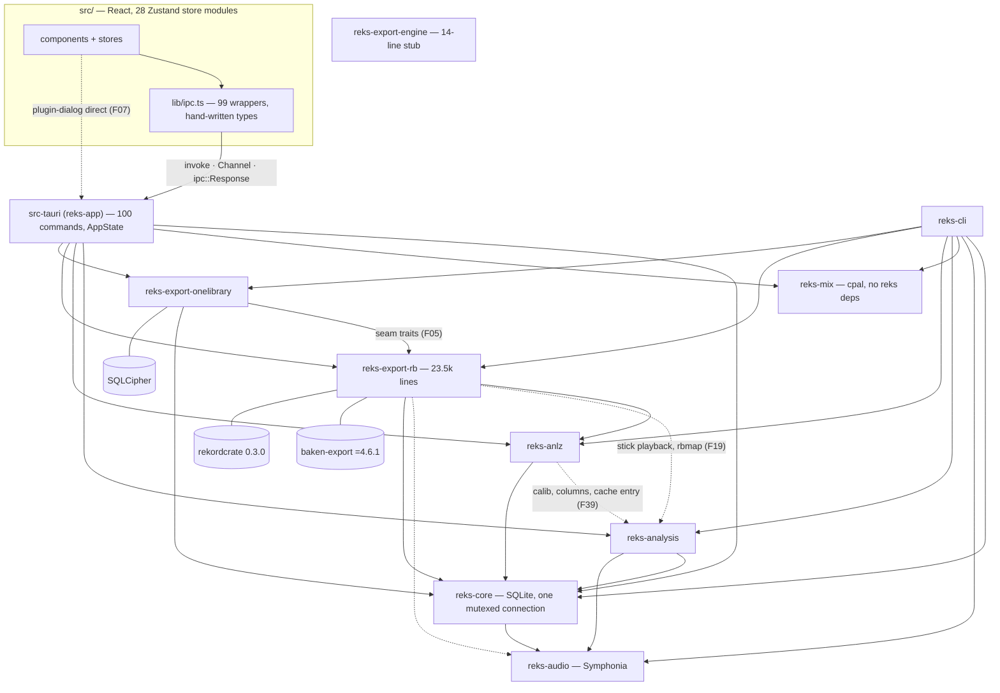

# Architecture review

Date: 2026-10-30, at `e6d9306` (v0.2.0 plus #84, #85). Read-only review: no code changed.
Scope: `crates/*`, `src-tauri/src`, `src/`. Method: four parallel code readers (core+cli,
audio+mix+analysis, anlz+export-\*, src-tauri+UI). Every P0 and P1 below was then re-read in
the code by the author of this report.

## Executive summary

1. **P0: 2 · P1: 5 · P2: 28 · P3: 12.**
2. Checks: `cargo clippy --all-targets -D warnings` is clean. `cargo test --workspace` gives 1,145 passed, 0 failed, 12 ignored. `npm test` gives 709 passed. `npm run lint` fails in any `.claude/worktrees` checkout because it processes 0 files (F34); with that exclusion lifted, the UI lints clean.
3. P0 F01: an XML import leaves reks's analysis grid rows next to rekordbox's rows. The mixed grid is permanent and reaches the decks, the XML export and reks-built `PQTZ`.
4. P0 F02: every default export deletes `exportLibrary.db`. OneLibrary-only players (OPUS-QUAD, XDJ-AZ, CDJ-3000X…) then see no library, and the dry run does not say so.
5. P1: `panic = "abort"` turns panics in third-party parsers into app aborts, for example on a damaged `export.pdb` (F03). reks-built ANLZ, which has not been tested on a player, is exported by default with no opt-in (F04).
6. P1: export apply, validation, history and profiles are shaped around rekordbox. Phase 6's Engine-only mode cannot run through them (F05).
7. P1: the snapshot-before-bulk-operation policy lives in `src-tauri`, so the CLI and newer bulk operations skip it (F06). Seven UI files call the Tauri dialog plugin outside `ipc.ts` (F07).
8. Sound: every stick write goes through `apply()`. The audio callback allocates nothing and takes no locks. `fsname` covers every FAT32 rule and is property-tested. Library crates have no unwrap or panic. Tokens and `ui/` components are respected.
9. Main debt: `reks-export-rb` is a 23.5k-line catch-all with four `export.pdb` decoders (F18, F19). IPC types are mirrored by hand (F23). Job bookkeeping in `src-tauri` is ad hoc (F21).
10. Order: F01 and F02 now. F03, F04, F06 and F07 within the current phase. F05 as the first Phase 6 task.

## Commands run

| Command | Result |
|---|---|
| `cargo metadata --format-version 1` | OK (graph below) |
| `cargo clippy --workspace --all-targets -- -D warnings` | exit 0. Note: `warning: the following packages contain code that will be rejected by a future version of Rust: binrw v0.14.2` (F47) |
| `cargo test --workspace` | exit 0: 1,145 passed, 0 failed, 12 ignored (all need hardware, a played-stick fixture, a rekordbox 7 reference, the OneLibrary key or the C++ keyfinder) |
| `npm test` | exit 0: 86 files, 709 tests passed |
| `npm run lint` | **exit 1**, output below (F34) |

```
> reks@0.2.0 lint
> biome check .

Checked 0 files in 6ms. No fixes applied.
check ━━━━━━━━━━━━━━━━━━━━━━━━━━━━━━━━━━━━━━━━━━━━━━━━━━━━━━━━━━━━━━━━━━━━━━━━━━━━━━━━━━━━━━━━━━━━━━━━━━━

  × No files were processed in the specified paths.

  i Check your biome.json or biome.jsonc to ensure the paths are not ignored by the configuration.

  i These paths were provided but ignored:

  - .
```

Re-run with a temp config that drops only `"!**/.claude"`: 85 diagnostics. All 85 are rules that the repo's own `overrides` turn off (`ui/**` export rule; the a11y rules in TrackTable and the three tree views). The overrides did not resolve from the temp config path, so these are expected. Nothing else was reported.

## Architecture as built



Notes (from `cargo metadata`; dashed edges are the ones that go beyond the crate's role in CLAUDE.md):

- **No cycles.** `reks-mix` has no runtime dependency on other reks crates (dev only), as D5/D21 intend. `reks-export-engine` is empty.
- **`reks-anlz → reks-analysis`.** The ANLZ format crate depends on the analyser (which pulls in `beat-this`/`rten`) for calibration constants, waveform columns and `cache::RekordboxEntry` (`reks-anlz/src/waveform.rs:13`, `deckwave.rs:14-16`, `grid.rs:16`).
- **`reks-export-rb → reks-audio, reks-analysis`.** These serve stick-track playback (`browse`) and analysis mapping (`rbmap`), not export.
- **`reks-export-onelibrary → reks-export-rb`.** The OneLibrary crate depends on the rekordbox crate because the generic seams (`OneLibraryExport`, `OneLibraryRead`) live there (D14, D38).
- **`reks-core → reks-audio`.** Used for scan, probe, convert and preview. This fits core's role.
- **Persistence.** `Library` holds a single `Mutex<Connection>` for reads and writes (`reks-core/src/db.rs:43-50`). Pragmas: WAL, `synchronous=NORMAL`, foreign keys on, busy_timeout 5 s. 13 migrations; the latest is `0013_grid_base.sql`.
- **Shell.** `AppState` (`src-tauri/src/state.rs:21-50`) holds five `Mutex<Option<CancelToken>>`, five `Mutex<Shown*>` plan slots, `Mix { slot: Arc<Mutex<MixSlot>> }` and the analysis handle. DB work runs through one `blocking()` helper. Binary payloads go back as `ipc::Response`, progress over `Channel`.
- **Audio.** cpal callback at `reks-mix/src/engine.rs:355-357` → `Processor::process` (`:407`). Allocation guards: `engine.rs:531` and `tests/dsp_realtime.rs:44`.

## Findings

| ID | P | Area | Issue | Evidence | Size |
|---|---|---|---|---|---|
| F01 | P0 | 5 Persistence | XML import mixes rekordbox and analysis grid rows | `reks-core/src/rbxml/import.rs:1071-1073` | M |
| F02 | P0 | 6 Export | Default export deletes `exportLibrary.db`; dry run doesn't warn | `reks-export-rb/src/writer/baken.rs:169` | S |
| F03 | P1 | 6/7 | Third-party panics abort the app (damaged `export.pdb`, baken's guard) | `Cargo.toml:117`; `pdbread.rs:298-302` | M |
| F04 | P1 | 6 Export | reks-built ANLZ (UNVERIFIED) exported by default, no opt-in | `reks-export-rb/src/plan/mod.rs:153,945-947` | S |
| F05 | P1 | 1/10 | Export orchestration is rekordbox-shaped; Phase 6 Engine-only blocked | `reks-export-rb/src/apply/mod.rs:327-329` | L |
| F06 | P1 | 1/5 | Snapshot-before-bulk policy lives in `src-tauri`; CLI and newer bulk ops skip it | `src-tauri/src/backup.rs:16` | M |
| F07 | P1 | 1 Layering | `@tauri-apps/plugin-dialog` used outside `ipc.ts` (7 files) | `src/components/ConvertDialog.tsx:8` | S |
| F08 | P2 | 6/11 | Export guard ignores `exportLibrary.db` history unless OneLibrary is on | `reks-export-rb/src/plan/onelibrary.rs:39` | S |
| F09 | P2 | 5 | XML re-import overwrites the manual BPM of an edited grid | `reks-core/src/rbxml/import.rs:747` | S |
| F10 | P2 | 5/6 | XML import can put two hot cues in one slot | `rbxml/import.rs:850-880` | S–M |
| F11 | P2 | 5 | Migrations run with foreign keys on (latent cascade) | `reks-core/src/db.rs:82,98` | S |
| F12 | P2 | 5 | An empty analysis result clears a tag/rekordbox BPM | `reks-core/src/analysis.rs:289-293` | S |
| F13 | P2 | 4 | Key-lock priming on the audio thread is unbounded (cost UNVERIFIED) | `reks-mix/src/keylock.rs:108-125` | M |
| F14 | P2 | 4 | CUE release during a pending load drops the load | `reks-mix/src/deck.rs:309-312,481-486` | S |
| F15 | P2 | 8/11 | Allocation guards miss the 3-band/FX blocks, SetGrid, preview deck | `reks-mix/src/engine.rs:574-584` | S |
| F16 | P2 | 6 | Stick writes: no fsync before rename; deletes predicted, not executed; ANLZ slots order-dependent | `writer/baken.rs:168,330` | M |
| F17 | P2 | 6/8 | Validator skips FAT32 names and file sizes; no `export.pdb` golden test | `reks-export-rb/src/validate.rs` | S |
| F18 | P2 | 2 | Four `export.pdb` decoders, five string helpers | `validate.rs:938`, `pdbread.rs:160`, `history/read.rs:283`, `diff.rs:338` | M |
| F19 | P2 | 2 | `reks-export-rb` holds non-export jobs | crate layout | M |
| F20 | P2 | 1/2 | Business rules in `src-tauri`, duplicated in `reks-cli` | `src-tauri/src/mix.rs:681-705`; `reks-cli/src/rb.rs:523-529` | M |
| F21 | P2 | 4/8 | Job and plan bookkeeping is ad hoc and untested (incl. restore guard) | `src-tauri/src/state.rs:53-96` | M |
| F22 | P2 | 7 | Preview-deck index panics in `mix_cue_edit`; `src-tauri` outside workspace lints | `src-tauri/src/mix.rs:452,670` | S |
| F23 | P2 | 3 | IPC types and constants mirrored by hand | `src/lib/ipc.ts:2-4,743,761` | M–L |
| F24 | P2 | 3/6 | Export defaults copied in TS | `src/store/exportWizard.ts:65-78` | S |
| F25 | P2 | 1/3 | Filter-rule codec lives in TS | `src/lib/ruleTree.ts:251-291,446-469` | M |
| F26 | P2 | 1/11 | File-system→player rule also worded in TS | `src/components/DevicesDialog.tsx:67` | S |
| F27 | P2 | 2/9 | IPC in components, triple drive polling, `mix.ts` does five jobs | `src/components/AdoptDialog.tsx:15-16`; `src/store/mix.ts` | M |
| F28 | P2 | 7/9 | One app-wide error boundary; Reload leaves the engine playing | `src/components/ErrorBoundary.tsx:47` | S |
| F29 | P2 | 3/10 | Stringly-typed source columns; cue kind ints copied in 3 crates | `reks-core/src/analysis.rs:40-46`; `cue.rs:31-32` | M |
| F30 | P2 | 2 | Parity harness has its own copy of the old beat rule | `reks-cli/src/parity.rs:663` | S |
| F31 | P2 | 6 | Case-only differences in folder spellings reach the PDB (UNVERIFIED) | `reks-core/src/fsname.rs:138-140` | S |
| F32 | P2 | 2 | Two waveform-column caches; the deck path re-decodes | `reks-analysis/src/columns.rs:117-131` | M |
| F33 | P2 | 2 | Modules doing several jobs | `reks-mix/src/deck.rs`; `rbxml/import.rs` | M |
| F34 | P2 | 8 | `npm run lint` checks 0 files in agent worktrees | `biome.jsonc:10` | S |
| F35 | P2 | 11 | Docs drift (17 places) | table below | S |
| F36 | P3 | 5 | Convert "add as new" drops My Tags, grid lock, grid base | `reks-core/src/convert.rs:790-822` | S |
| F37 | P3 | 2 | Dead code: Phase 1 overview, `reks_mix::Player`, `core_version` | `reks-audio/src/decode.rs:176` | S |
| F38 | P3 | 2 | Small duplications | various | S |
| F39 | P3 | 1 | rekordbox waveform calibration lives in `reks-analysis` | `reks-analysis/src/calib.rs:1-3` | S |
| F40 | P3 | 4 | Echo clears 1.5 MB on the audio thread when its gate closes | `reks-mix/src/channel_echo.rs:294` | S |
| F41 | P3 | 4 | Audio thread priority on Linux (UNVERIFIED) | `Cargo.lock` | S |
| F42 | P3 | 6 | Different-stick check passes when both serials are `None` | `reks-export-rb/src/apply/mod.rs:489` | S |
| F43 | P3 | 7 | Post-database export errors are strings | `ExportReport.errors: Vec<String>` | S |
| F44 | P3 | 4 | Blocking work on the wrong thread | `src-tauri/src/mix.rs:1065`; `history.rs:122` | S |
| F45 | P3 | 9 | History view has no loading or error state | `src/components/HistoryTree.tsx:119-124` | S |
| F46 | P3 | 9 | One-off sizes in feature components | `src/components/SettingsDialog.tsx:69` | S |
| F47 | P3 | 8 | `binrw` 0.14 future-incompat warning | `Cargo.toml:44-45` | S |

### F01 · P0 · XML import mixes rekordbox and analysis grid rows

- Evidence:
  - `reks-core/src/rbxml/import.rs:796-811`: `write_grid` skips only user-owned grids ("rekordbox rows beside manual ones would mix two grids").
  - It then calls `replace_rows`, which deletes only rekordbox rows (`import.rs:1071-1073`: `"DELETE FROM {table} WHERE track_id = ?1 AND source = ?2"`). `analysis` rows stay.
  - After that, `analysis.rs:268-274` sees a non-analysis row and never rewrites the grid again.
  - Readers take every row whatever its source: `beatgrid/mod.rs:294-296` (`ORDER BY position_ms, id`, used by decks and grid mode), `rbxml/export.rs:416-419`, `reks-export-rb/src/reksanlz.rs:208`.
  - No test covers "analyse, then import" (`tests/rbxml_grid.rs`).
- Why it matters: "add folder" followed by "import collection.xml" is a normal first run, and the queue analyses scanned tracks at once (D10 "Queue"). The two grids' anchors interleave, so the library grid is corrupt for good. It reaches the decks, the XML sent back to rekordbox, and reks-built `PQTZ`. That last one applies under `reksFirst`, for tracks with no rekordbox cache, and for user-owned grids.
- Fix:
  - When the XML has `TEMPO` rows for a grid that isn't user-owned, delete all non-manual rows. The analysis cache keeps reks's result (D10).
  - Add a data migration that deletes `analysis` rows on tracks that also have `rekordbox` rows. Under D41 this is a breaking release.
  - Add the missing test.

### F02 · P0 · Default export deletes `exportLibrary.db`; the dry run doesn't warn

- Evidence:
  - `reks-export-rb/src/writer/baken.rs:169` sets `onelibrary: false`.
  - baken-export 4.6.1 `src/lib.rs:940` then runs `None => remove_onelibrary(&rb_dir, &mut report)`, which removes `exportLibrary.db`, `-wal`, `-shm` and `exportExt.pdb` (`lib.rs:988-996`).
  - The dry run mentions the file only as play history (`dryrun.rs:673-681`: "…players may have logged plays there", "Exporting rebuilds the stick's database, which erases it").
  - The "Remove" file list shows only when OneLibrary is on (`src/components/ExportWizard.tsx:674-681`).
  - `research.md:108`: "OneLibrary only: CDJ-3000X, CDJ-1500X, OPUS-QUAD, OMNIS-DUO, XDJ-AZ, XDJ-AN". `check/players.rs:59-66` already knows this. No `TargetProfile` is a OneLibrary-only player.
- Why it matters: a rekordbox 7 stick that plays on an OPUS-QUAD or XDJ-AZ shows no library after its first reks sync or adopt-and-sync. This is a stick that fails on a player, from a default export, without a word in the dry run.
- Fix:
  - When `exportLibrary.db` exists and OneLibrary is off, raise a dry-run warning that names the OneLibrary-only players and lists the four files as deletes. Require a confirmation, as discarding history does.
  - Optionally, add a OneLibrary-only target that requires the OneLibrary option.

### F03 · P1 · Third-party panics abort the app

Hard rule: no panics on user data. Not P0: it needs damaged or odd input, and an abort loses no library data (WAL).

- Evidence:
  - `Cargo.toml:117` sets `panic = "abort"`, and nothing in the workspace uses `catch_unwind`.
  - rekordcrate 0.3.0 `src/pdb/string.rs:164`: `#[br(count = usize::from(header >> 1) - 1)]`. A short-string header `0x01` passes the LSB assert and underflows. In release that wraps to `usize::MAX`, and binrw 0.14.2 `src/helpers.rs:462` `bytes.reserve_exact(n)` then panics ("capacity overflow"). In debug it is "attempt to subtract with overflow".
  - The path is reached from:
    - `pdbread.rs:298-302` (`DeviceSQLString::read`; used by Devices browse, check-a-stick and the OneLibrary writer);
    - `history.rs:653` (`Page::read_options`, which parses rows eagerly in every dry run's history count);
    - `validate.rs:1031`.
  - baken-export `lib.rs:842-847` wraps `prepare` in `catch_unwind` for "a decoder on a broken file". Under abort, that panic kills the app in the middle of `apply`.
  - `decisions.md:1424-1426` (D38) says release builds "wrap"; in fact they panic.
- Why it matters:
  - Check-a-stick exists to diagnose damaged sticks and dies on one.
  - A damaged stick shown in the Devices sidebar kills playback.
  - A broken audio file can abort an export halfway. What that leaves on the stick is UNVERIFIED; `export.pdb` itself is replaced last.
  - The background analysis worker has the same exposure if Symphonia ever panics (UNVERIFIED).
- Fix: either
  - (a) one reks-owned, bounds-checked DeviceSQLString/row decoder, used by every reader (with F18), and no eager rekordcrate row parse on untrusted pages; or
  - (b) `panic = "unwind"` plus `catch_unwind` around foreign-stick reads, the analysis worker and `apply`.
  
  (b) also restores baken's own guard. See "Decisions that look wrong".

### F04 · P1 · reks-built ANLZ (UNVERIFIED) is exported by default with no opt-in

Hard rule: "Anything that cannot be verified … guarded by a feature flag in code."

- Evidence:
  - `plan/mod.rs:153` sets `anlz_preference: AnlzPreference::RekordboxFirst`.
  - `plan/mod.rs:945-947`:
    - `_ if t.grid_user_owned => ours().or_else(regrid)` sends every edited or locked grid through reks-built or `ReksGrid` sets;
    - `RekordboxFirst => rekordbox().or_else(ours)` exports reks's ANLZ for every track only reks analysed.
  - These sets carry no PQT2, PSSI or PVB2 (`reksanlz.rs:20-23`).
  - The only mitigation is the label "(UNVERIFIED on players)" (`dryrun.rs:459`).
  - D7 marks this ordering "proposed, for the maintainer to confirm" (`decisions.md:158-160`).
  - Every other UNVERIFIED writer path defaults off: `dividers`, `onelibrary`, `active_loops` (`plan/mod.rs:152-155`).
- Why it matters: for a standalone rekordbox alternative, most new tracks will take this path. A stick that fails on stage is the worst bug the project names.
- Fix: a maintainer decision. Either:
  - keep the default and record it as an accepted exception to the flag rule; or
  - default to `RekordboxOnly`. Tracks with no rekordbox ANLZ then fall to `missing_analysis`, default `Skip` (`plan/mod.rs:146`).
  
  Either way, the edited-grid branch needs the same treatment.

### F05 · P1 · Export orchestration is rekordbox-shaped; Phase 6 is blocked

- Evidence:
  - `apply` takes `writer: &dyn RekordboxWriter` (`apply/mod.rs:327-329`).
  - It always validates `export.pdb` (`:421-422`) and builds the manifest from the PDB read-back.
  - Copies and prune are carried out by baken, not by `apply` (`writer/baken.rs:168` `prune: !plan.options.keep_stale`).
  - History backups cover only `*.pdb` and `exportLibrary.db*` (`history.rs:442`).
  - `TargetProfile` is Pioneer-only (`target.rs:8`), and core stores it as free text (`reks-core/src/device.rs:41` `pub target: String`).
  - The shell and UI are typed on rekordbox types: `src-tauri/src/state.rs:59` holds an `ExportPlan`; `src/lib/ipc.ts:1529` has the `TargetProfile` union; `ExportWizard.tsx:64-70` hard-codes `TARGETS`.
- Why it matters: Phase 6 task 9 wants an "Engine target with schema picker and 'also write Pioneer' combined mode" (`phase-6.md:137`).
  - Engine-only: nothing copies the audio.
  - Combined: baken prunes `/Contents` down to its own track set, so tracks skipped for missing ANLZ disappear for Engine too.
  - `hm.db` has no place in the history model.
- Fix: before task 9, extract a format-neutral export layer:
  - plan core with per-target sections;
  - an `apply` that does copies and deletes itself and calls writer and validator traits (baken run with `prune: false`);
  - history guard and backup behind per-target readers;
  - a target-family enum in core.
  
  Move the OneLibrary seams there too. Do it in steps: it also fixes F16 and F19.

### F06 · P1 · The snapshot-before-bulk policy lives in `src-tauri`

Hard rule: business logic stays in `crates/`.

- Evidence:
  - `backup::before_bulk` (`src-tauri/src/backup.rs:16`) is called only at `commands.rs:289` (XML), `commands.rs:705` (convert replace) and `history.rs:185`.
  - `reks-cli` has no snapshot call. `import-xml` runs `rbxml::import(&collection, &lib, opts, |_| {})?` straight away (`reks-cli/src/main.rs:164`).
  - These GUI operations take no snapshot either: bulk edit (`commands.rs:96-105`), adopt apply (`adopt.rs:74`), relocate apply (`relocate.rs:125`) and comment-tag sync (`commands.rs:155-164`).
  - D36 says "future bulk edit and merge do the same" (`decisions.md:1300-1303`).
- Why it matters: whether cues, grids and tags are protected depends on the front end. The CLI is the hardware-test tool.
- Fix: `Library::with_snapshot(reason, f)` in core, used by the bulk operations themselves. New `BackupReason` variants. Update D36.

### F07 · P1 · Dialog plugin called outside `ipc.ts`

Hard rule: Tauri calls go through `src/lib/ipc.ts` only. Low runtime risk.

- Evidence: `import { open } from "@tauri-apps/plugin-dialog"` appears in `ConvertDialog.tsx:8`, `ImportWizard.tsx:10`, `HistoryImportDialog.tsx:11`, `SettingsDialog.tsx:11`, `AppHeader.tsx:12` and `relocateActions.ts:2`. `store/report.ts:7` imports `save`.
- Why it matters: each test mocks the module itself, and picker options drift between files.
- Fix: `pickFolder`, `pickFile` and `pickSavePath` in `ipc.ts`.

### F08 · P2 · Export guard ignores `exportLibrary.db` history unless OneLibrary is on

- Evidence: `plan/onelibrary.rs:39` returns early with `if !plan.options.onelibrary { return Ok(()); }`, so `guard.onelibrary_sessions` stays empty.
- This contradicts `phase-4.md:230` ("The Phase 2.5 export guard covers `exportLibrary.db`") and `plan/mod.rs:34`.
- Not P1: the D23 backup still copies the file by default, so the plays can still be imported from the backup.
- Fix: scan its history whenever the file exists and a key resolves.

### F09 · P2 · XML re-import overwrites the manual BPM of an edited grid

- Evidence:
  - `rbxml/import.rs:747`: `bpm_source = CASE WHEN :bpm IS NULL THEN bpm_source ELSE 'rekordbox' END`.
  - The edited grid itself is kept (`:804`), and grid edits store BPM as `manual` (`beatgrid/mod.rs:185,246-258`).
  - `tests/rbxml_grid.rs:106-128` checks only the grid.
- Effect: the PDB browse tempo and the XML `AverageBpm` disagree with the grid, for example after halving it.
- Not P0: the grid, sync and `PQTZ` stay right.
- Fix: leave the BPM alone when the grid is user-owned or `bpm_source = 'manual'`, and extend the test.

### F10 · P2 · XML import can put two hot cues in one slot

- Evidence:
  - `set_hot_cue` refuses an occupied slot (`cue.rs:125-129`), but `write_cues` (`rbxml/import.rs:850-880`) inserts every `POSITION_MARK`.
  - `replace_rows` removes only rekordbox rows.
  - No unique `(track_id, slot)` constraint exists (`0001_init.sql`).
  - The ANLZ writer does not dedupe: `reks-anlz/src/cue.rs:154` `Some(s) if s < HOT_SLOTS => hot.push(...)`.
- What a player does with two cues in one slot is UNVERIFIED. This becomes P0 if a player mishandles it.
- Fix: in the import, skip and warn on such a cue. Add a partial unique index with a cleanup migration.

### F11 · P2 · Migrations run with foreign keys on

- Evidence: `db.rs:82` sets `foreign_keys = ON`, then `db.rs:98` runs `migrate(&mut conn)` inside rusqlite_migration's transaction, where the pragma cannot be changed.
- Latent: a future rebuild of `track`, `playlist`, `tag` or `device` (DROP + rename) would cascade-delete cues, grids, entries and tags. Only the pre-migration snapshot would save them. This becomes P0 the day such a migration lands.
- Fix: turn foreign keys off around `migrate`, then run `PRAGMA foreign_key_check`. Add a test that a rebuild keeps child rows.

### F12 · P2 · An empty analysis result clears a tag or rekordbox BPM

- Evidence: `analysis.rs:289-293` writes `rec.bpm_x100` whenever `bpm_source != 'manual'`, and `reks-analysis/src/pipeline.rs:118-122` sets it to `None` when no grid was found.
- This goes against D10's "analysis only fills in".
- Fix: write the BPM only when it is `Some`.

### F13 · P2 · Key-lock priming on the audio thread is unbounded

The mechanism is CONFIRMED; whether it overruns the callback is UNVERIFIED.

- Evidence: `keylock.rs:108-125` resets `timestretch` and runs the whole preroll loop inside the callback. It is triggered by:
  - every loop wrap (`deck.rs:857-858` → `jump_with` sets `Head::Copy`, `:874`, then `:1007` `self.kl.jump(...)`);
  - every sync phase jump (`graph.rs:409-411`);
  - every head flip at the key-lock range edge, which has no hysteresis (`deck.rs:963`, `keylock.rs:35`).
- The cost is estimated at 0.6–2 ms per prime on an M4 Pro. The UI offers 1/64-beat loops (`src/lib/mixView.ts:193`).
- D21 documents the per-jump cost but sets no cap.
- Fix: before the Phase 5 key-lock choice:
  - feed the stretcher continuously across loop wraps;
  - add hysteresis;
  - cap or spread the priming;
  - add a µs-per-prime bench.

### F14 · P2 · CUE release during a pending load drops the load

- Evidence: `deck.rs:309-312` (`CueRelease` → `return_to_cue`) reaches `deck.rs:483` `self.pending = Pending::Cue`, overwriting `Pending::Load`. `cue_button` guards against this (`:461`); this path does not.
- Effect:
  - The engine stays on the old track while the UI shows the new one.
  - A later grid edit sends `SetGrid` with the new PCM, which swaps the audio with no fade (a click).
- Not P0: it needs CUE released within the 5 ms fade of a load.
- Fix: leave a pending Load alone. Have `SetGrid` refuse a source whose PCM isn't `Arc::ptr_eq` to the loaded one. Add a graph test.

### F15 · P2 · Allocation guards miss the newer blocks

- Evidence: the callback guard sends only `Trim … Cue` (`engine.rs:574-584`). It never sends `Eq3*`, `ChannelFx`, `FxParameter`, `SetGrid`, `SeekExact` or `CueRelease`, and never uses the preview deck.
- `tests/dsp_realtime.rs:10-15` imports none of eq3, channel filter, echo or reverb.
- `mixer-dsp.md:247,256` claims every block and control is covered.
- Reading echo and reverb found no allocation, so this is a coverage gap, not a known defect.
- Fix: add the missing controls, plus key lock with loop wraps, and correct the doc.

### F16 · P2 · Stick writes: durability and determinism

- Evidence:
  - baken writes `export.pdb` as temp + rename with no fsync (baken-core `fsname.rs:85`).
  - ANLZ files are rewritten in place (`write_if_changed`).
  - reks's own `sync_written` runs only after baken has finished (`apply/mod.rs:416`), and it fsyncs only `ANLZ0000.*` (`:660-662`).
  - The plan's `deletes` are a prediction: baken prunes everything outside its own `wanted` set (baken `lib.rs:955-958`), so files added after the dry run are deleted without being shown.
  - ANLZ slot numbers follow plan order (`writer/baken.rs:330`).
- `writer/mod.rs:23` claims "a crash leaves one or the other". That holds for an app crash, not for an unplug.
- Not P1: the run then reports Problems, and a re-export repairs the stick.
- Fix (with F05):
  - run baken with `prune: false`, fsync, then delete `plan.deletes` inside `apply`;
  - assign slots deterministically by `dst_rel`;
  - send baken a PR to fsync before the rename.

### F17 · P2 · Export verification gaps

- `validate.rs` never calls `fsname::check_path`, although CLAUDE.md:121 says "FAT32 rules enforced by our validator".
- It checks that audio files exist, not their sizes.
- It doesn't check `.2EX` for tracks reks didn't build, artwork, or the stick's `exportLibrary.db`.
- No test compares our `export.pdb` with `fixtures/onelibrary/ref-7.2.19/PIONEER/rekordbox/export.pdb`, which is rekordbox's export of the same fixture tracks. `diff/tests.rs:82` only asserts that a different export differs.
- Fix: walk the written files through `check_path` and compare sizes. Add a golden diff with an allow-list. That is also the strongest guard for a baken bump.

### F18 · P2 · Four `export.pdb` decoders

- Track-row decoders: `validate.rs:938`, `pdbread.rs:160`, `history/read.rs:283`, `diff.rs:338`.
- There are five DeviceSQLString helpers, repeated `u16_at`/`u32_at`, and three case-insensitive locators.
- They differ in how lenient they are, and the F03 fix would have to be made five times.
- Fix: one `pdb` module with strict and lenient modes.

### F19 · P2 · `reks-export-rb` holds non-export jobs

- Production lines by job:

  | Job | Lines (prod) |
  |---|---|
  | Planning | 3.7k |
  | Apply and writer | 1.9k |
  | Validate | 1.2k |
  | PDB and history readers | 1.6k |
  | Dev diff tool | 1.3k |
  | Check-a-stick | 2.0k |
  | Devices and eject | 1.6k |
  | Adopt | 0.6k |
  | Stick playback (`browse::deck_audio`) | 0.4k |
  | `rbmap` | 0.1k |

- Playback and `rbmap` are why the crate depends on `reks-audio` and `reks-analysis`.
- Fix: split along the F05 seams: stick reading and checking, devices, export.

### F20 · P2 · Business rules in `src-tauri`, duplicated in `reks-cli`

- A deck rule ("While a loop plays, MEMORY saves the loop") and a cue-slot lookup sit in `src-tauri/src/mix.rs:681-705`.
- Backup-or-stick detection is in `src-tauri/src/history.rs:125`, with a drifting copy in `reks-cli/src/history.rs:131` (only the CLI canonicalises).
- The target fallback is in `browse.rs:56-64`.
- The rbmap → enqueue orchestration is in `analysis.rs:78-137`, duplicated in `reks-cli/src/rb.rs:178`.
- The CLI repeats `plan::plan` to pass a stand-in serial (`rb.rs:523-529` vs `plan/mod.rs:574-581`), so any new guard would skip the hardware-test tool.
- Fix: move each rule into its crate; add `plan::plan_with_serial`.

### F21 · P2 · Job and plan bookkeeping is ad hoc

- There are five `Shown*` structs with five copies of the "take if id matches" code (`state.rs:53-96`).
- `export_apply` takes the plan (`commands.rs:556`) before checking `export_cancel` (`:568-574`), so a refused second click loses the plan. `convert_apply` does the same (`:682`, `:694-700`).
- `scan_start` ignores `relocate_cancel`, although `relocate.rs:46` says the two never run at the same time.
- The restore guard (`backup.rs:72-83`) checks four jobs, but not the analysis queue, rbmap, relocate, history, adopt or remap, and it holds nothing while `restore_backup` runs.
- That last gap is downgraded from the reviewer's P1: production code never deletes tracks, so an in-flight analysis result can only land on the same track.
- `src-tauri` has no unit tests outside `mix.rs` and `logging.rs`.
- Fix: one `Jobs` registry (kind, exclusion table, RAII guard) plus a generic `Shown<T>`, in a pure, tested module. Restore takes the exclusive guard and pauses the queue.

### F22 · P2 · Preview-deck index panics in `mix_cue_edit`

- `deck_index` accepts deck 4 (`mix.rs:452`). Then `engine.poll_state().decks[i]` (`mix.rs:670`) indexes an array of 4, which panics and, under abort, kills the app.
- The UI never sends deck 4 there today (`src/store/mix.ts:852-855`).
- `src-tauri/Cargo.toml` has no `[lints] workspace = true`, so the unwrap, expect and panic denies (`Cargo.toml:104-109`) don't apply to it.
- Fix: `decks.get(i)` or refuse the preview deck. Opt `src-tauri` into the workspace lints.

### F23 · P2 · IPC types and constants are mirrored by hand

- `ipc.ts:2-4` says its types "mirror the Rust serde shapes": 176 hand-written types. Only the query JSON is pinned by a Rust test (`reks-core/tests/query.rs:689`).
- Constants are copied by hand:
  - `COLUMNS_PER_SECOND` (`ipc.ts:743`)
  - `DETAIL_POINTS_PER_SECOND`
  - `DECKS` (`ipc.ts:761`)
  - `LOOP_SIZE_MIN/MAX` (`mixView.ts:276-277`)
- `mockBackend.ts` is a third copy.
- serde tags are mixed: 14 types use `tag = "type"` and 4 use `tag = "kind"`.
- No mismatch was found today: all 99 argument names match.
- Fix: generate types and constants with ts-rs or specta (licence-check first) and diff them in CI.

### F24 · P2 · Export defaults copied in TS

- `src/store/exportWizard.ts:65-78` copies `plan/mod.rs:141-157`, including the defaults for the UNVERIFIED flags. The wizard always sends the full object, so `serde(default)` never applies.
- Fix: an `export_default_options` command, or a generated constant.

### F25 · P2 · Filter-rule codec lives in TS

- `ruleTree.ts:251-291` encodes "rating at most / exactly" as `ratingMin` plus negation, and "tag all of" as a group of `tagAny`. Reading back relies on matching those shapes (`:446-469`).
- These rules persist in saved filters and smart playlists.
- The file is 946 lines and does three jobs.
- Fix: core `ratingRange` and `tagAll` filters so the codec maps 1:1, then split the file.

### F26 · P2 · File-system→player rule also worded in TS

- `DevicesDialog.tsx:67` says "exFAT: newer players only. FAT32 works everywhere."
- Rust words the same rule differently (`check/text.rs:158`), against D38's "worded in Rust".
- `check/text.rs:161` and `check-a-stick.md:35` say "FAT32 works on every player" while `hw-test-log.md` is empty.
- Fix: Rust returns a target-aware note with `DeviceInfo`; cite AlphaTheta in the wording.

### F27 · P2 · IPC in components, triple drive polling, `mix.ts` does five jobs

- Six components call `ipc` directly. `AdoptDialog.tsx:15-16` and `HistoryImportDialog.tsx:16-20` run whole plan/apply flows in `useState`; the others are `TrackDetailPanel`, `PlayedIn`, `LocateDialog` and `BulkEditPanel`.
- The drive list is fetched by three loops: `deviceBrowser.ts:236`, `DevicesDialog.tsx:132` and `HistoryImportDialog.tsx:64`.
- `src/store/mix.ts` (1,009 lines) holds engine lifecycle, state copy, loads, mixer, pads, cue edits, device switching and a hook.
- Fix: stores for the adopt and history flows, a `useDevicePolling` hook, and a split of `mix.ts`.

### F28 · P2 · One app-wide error boundary; Reload leaves the engine playing

- There is one boundary (`main.tsx:31`), and its button reloads the page (`ErrorBoundary.tsx:47`).
- The mix store then starts as `"stopped"` (`mix.ts:545`) while the engine keeps playing. Nothing re-attaches it (`src-tauri/src/lib.rs:47-53`).
- Fix: a boundary per region, and `mix_attach` or `mixStop` on mount.

### F29 · P2 · Stringly-typed source columns; cue-kind ints copied

- `key_source`, `bpm_source`, `beatgrid.source`, `cue.source` and `analysis_source` are `&str` constants (`analysis.rs:40-46`) plus a duplicate (`rbxml/import.rs:41`).
- About 13 raw literals remain in production code, including `cue.rs:156,201`, `analysis.rs:110-135,243` and `import.rs:745-747`.
- They reach the UI as `Option<String>`, where `useDeckGridModes.ts:81` compares `grid?.source === "manual"`.
- `item_kind` literals sit in SQL although `EntryKind` exists (`history/sessions.rs:92-192`, `query.rs:284,557`).
- `KIND_CUE`/`KIND_LOOP` are declared in `reks-core/src/cue.rs:31-32`, `reks-core/src/deck.rs:15-16`, `reks-export-rb/src/browse/anlz.rs:17-18` and `reks-anlz/src/cue.rs:18`. Phase 6 would add a fifth copy.
- Fix: `DataSource`/`AnalysisSource`/`CueKind` enums with ToSql/FromSql and serde. `ManifestItemKind` already does this right.

### F30 · P2 · Parity harness has its own copy of the old beat rule

- `reks-cli/src/parity.rs:609-697` uses `if time >= end { break; }` (`:663`), the rule D10 replaced, and assumes 4/4.
- The effect on the published parity numbers is UNVERIFIED and probably small.
- Fix: use `reks_core::beatgrid::grid_beats`.

### F31 · P2 · Case-only differences in folder spellings reach the PDB

UNVERIFIED.

- `fsname.rs:138-140` calls folders that differ only in case "harmless". `deadmau5` and `Deadmau5` become one folder on disk but two `stick_path` spellings in the PDB.
- That a player resolves both is untested.
- Fix: plan with the first spelling for each case-folded folder.

### F32 · P2 · Two waveform-column caches; the deck path re-decodes

- `cache.rs:44-45` (`bands.bin`) and `columns.rs:21-23` (`columns.bin`) share magic `RKWC`, version 1, but differ in layout. `cache.rs:8-9` still says "to be merged".
- `track_columns` (`columns.rs:117-131`) never reads `bands.bin`, so the first deck or grid-mode view of an analysed track decodes the whole file again.
- Fix: one format; try the stored columns first.

### F33 · P2 · Modules doing several jobs

- `reks-mix/src/deck.rs` (1,112 production lines: deck logic plus read-head management; F13's fix needs the split).
- `reks-core/src/rbxml/import.rs` (1,299: preview, matching, DB write, playlists).
- `reks-analysis/src/grid.rs` (897: Mixxx port mixed with reks's tempo fit; splitting it would make the GPL-2.0+ attribution boundary explicit).
- `reks-mix/src/graph.rs` (2,051, of which about 1,560 are tests mostly of `Deck`).
- `reks-core/src/convert.rs` (947) and `settings.rs` (694 production lines, including the cache move).
- Fix: split each when it is next touched.

### F34 · P2 · `npm run lint` checks 0 files in agent worktrees

- `biome.jsonc:10` has `"!**/.claude"`. The comment says it is meant to skip nested worktrees, but it also matches when the checkout itself sits in `.claude/worktrees/`, which is where coding sessions run.
- Format and lint drift then surfaces only in CI.
- Fix: anchor the glob to the project root, then confirm in a worktree that `npm run lint` checks about 333 files.

### F35 · P2 · Docs drift

| Doc says | Code does |
|---|---|
| D38 `decisions.md:1424-1426`: release builds "wrap" | wrap → `reserve_exact` panic (F03) |
| `phase-4.md:230`, `plan/mod.rs:34`: guard covers `exportLibrary.db` | only with OneLibrary on (F08) |
| D36 `decisions.md:1300-1303`: bulk edit snapshots | it doesn't (F06) |
| CLAUDE.md:121 "FAT32 rules enforced by our validator" | no `check_path` in `validate.rs` (F17) |
| `writer/mod.rs:23` "a crash leaves one or the other" | not on unplug (F16) |
| `mixer-dsp.md:247,256` guards cover every block/control | F15 |
| CLAUDE.md:58 `reks-mix` "(player now, mixer Phase 5)" | mixer shipped (D21, D30) |
| CLAUDE.md "positions … milliseconds (i64)" | `cue.start_ms/end_ms` are REAL/`f64` (`track.rs:68-69`), as `phase-1.md:149-151` intends |
| D7 `decisions.md:119` `anlz_roots` "pointing at rekordbox's local analysis cache" | empty root, entries injected in `reconcile` |
| D5 `decisions.md:102-103`: 60-min limit "for preview" | also analysis, columns, transients (`float.rs:83-85`) |
| D40 `decisions.md:1486`: "a 2-hour mix costs no more than a 10-minute track" | `decode.rs:26` refuses over 60 min |
| D10 `decisions.md:310`: nothing reads columns from the cache | `columns.rs:154` builds thumbnails from rekordbox entries |
| `phase-5.md:74-88` interface block | `source.rs:42` `&[GridBeat]`, `control.rs:43` `frame`, `TakeMaster` |
| D26 Radix list | omits Tabs (`package.json:28`, `ui/Tabs.tsx`) |
| `backups.md`: restore "waits" during a job | refuses (`backup.rs:46-50`) |
| `db.rs:70` "(D39)" | D36 |
| `fsname.rs:4` "Engine DJ exporters (Phases 4/5)" | Phase 6 |

### P3 findings

- **F36** Convert "add as new" copies the track row, cues and grid, but not `track_tag`, `grid_locked` or `grid_base` (`convert.rs:790-822`). `phase-2.6.md:95` promises "the same metadata". Fix: copy them in the same transaction.
- **F37** Dead code:
  - The Phase 1 overview is built on every decode (`decode.rs:176,208`) and written on every `deck_audio` (`reks-core/src/preview.rs:43-44`). Only tests read it.
  - `reks_mix::Player` (433 lines, its own device-loss logic) serves one CLI call (`reks-cli/src/main.rs:196`) and is reks-mix's only serde use.
  - `core_version` is registered (`src-tauri/src/lib.rs:22-26,79`) but never called.
- **F38** Small duplications:
  - the 3-band split (`waveform.rs:200-203,246-248` and `detail.rs:73-76,96-100`; D40 promises one);
  - `AUDIO_EXTENSIONS`/`is_audio` (`scan.rs:33` and `relocate/plan.rs:27`);
  - the dry-run `Section`/`Facts`/`list` helpers (`ExportWizard.tsx:802-834` and `ConvertDialog.tsx:452-484`);
  - stick-layout paths in five places (`plan/stick.rs:36-38`, `validate::PDB_PATH`, `onelibrary::DB_PATH`, `apply/mod.rs:637`, `writer/baken.rs:471`);
  - the `history.baseline_date` literal (`history/mod.rs:584`).
- **F39** `reks-analysis/src/calib.rs` maps columns to rekordbox's PWAV…PWVC bytes. Only `reks-anlz` uses it (re-export at `reks-anlz/src/waveform.rs:13`), and it is the main reason for the `anlz → analysis` edge. Fix: move it to `reks-anlz`.
- **F40** `channel_echo.rs:294` `self.line.fill(...)` clears up to 1.5 MB per channel in one callback when the gate closes. Fix: skip it (the line is already below 1e-6) or spread it over blocks.
- **F41** UNVERIFIED: `Cargo.lock` shows no `audio_thread_priority` under cpal 0.18.2, while analysis runs cores − 1 workers (`reks-analysis/src/queue.rs:70`). Check during the Phase 5 soak test.
- **F42** `apply/mod.rs:489` `if found != plan.history.volume_serial` treats `None == None` as the same stick. Fix: also compare label, size and a `/Contents` fingerprint.
- **F43** `ExportReport.errors` is a `Vec<String>`, and `sync_written`/`write_onelibrary` return `String`. Fix: a typed enum.
- **F44** Blocking work on the wrong thread:
  - The sync `mix_control` (`mix.rs:1065`) runs on the main thread and waits on the `slot` lock that `mix_start` holds while opening the device (`:331-338`). How long it blocks is UNVERIFIED.
  - `history_scan` runs `volume_serial` (a `diskutil` subprocess) outside `spawn_blocking` (`history.rs:122`).
  - `move_cache_dir` holds the DB mutex for the whole copy (`reks-core/src/settings.rs:436-489`).
- **F45** `HistoryTree.tsx:119-124` shows "No sessions yet" before the first load and after a failed one. `SessionView.tsx:35-39` shows its error as plain text inside an `aria-busy` section.
- **F46** One-off sizes in feature components:
  - `ErrorBoundary.tsx:35` `max-w-[480px]`
  - `SettingsDialog.tsx:69` `h-[648px]`
  - `KeyGrid.tsx:24` `repeat(6,36px)`
  - `TrackTable.tsx:80` `w-[3px]`
  - `columns.tsx:144` `tracking-[-1px]`
- **F47** `binrw` 0.14.2 triggers E0365 ("extern crate `binrw` is private and cannot be re-exported"), a future-incompatibility lint. It is pinned to rekordcrate 0.3.0's version (`Cargo.toml:44-45`), so a future toolchain bump will break the build. Fix: track it; bump with rekordcrate or patch it.

## Verdict by area

1. **Layering: Issues F05, F06, F07, F20, F25, F26, F39.**
   - Checked the `cargo metadata` graph (no cycles; reks-mix isolated) and every `src-tauri` module for business logic and file writes. src-tauri writes no stick or library files; it only writes logs, the user-chosen report and the backup dir.
   - Grepped `src/` for `invoke`, `listen`, `Channel`, `convertFileSrc` and `@tauri-apps/*` outside `ipc.ts`: only the dialog plugin.
   - There is no beat rule, key logic or PDB/ANLZ knowledge in TS.
2. **Module health: Issues F18, F19, F27, F30, F32, F33, F37, F38.**
   - Listed every file over 800 Rust lines or 600 TS lines.
   - Resampling is not duplicated: load-time FFT and real-time sinc do different jobs.
   - The beat rule exists once (reks-core `grid_beats`, used by `BeatMap` via `deck_beats`).
3. **Types and data flow: Issues F23, F24, F29.**
   - `Control`, plan, warning and problem types are tagged unions.
   - There is no `any` or `as unknown as` at the IPC boundary.
   - Closed sets in TS are string unions.
   - Units: i64 frames at the engine API, i64 samples at 44.1 kHz in analysis, whole-ms grids.
4. **State and concurrency: Issues F13, F14, F21, F22, F40, F41, F44.**
   - Traced every function reachable from the cpal callback: no heap allocation, frees, locks, I/O, logging, unwrap or unchecked indexing. NaN is sanitised and denormals are flushed. Old sources retire off the thread except in F14.
   - Queue-full behaviour is defined for all three queues.
   - No `std::sync::Mutex` is held across `.await`, and no command holds two `AppState` locks.
   - Long jobs stream progress over `Channel` and have cancel tokens.
5. **Persistence: Issues F01, F09, F10, F11, F12, F36.**
   - Checked the pragmas, and that every multi-statement write runs in one transaction: import, bulk edit, relocate, folder change, playlist, tag and history ops, convert.
   - Backup and restore follow D36: online API, `.partial` then rename, `integrity_check`, too-new refusal, before-restore snapshot, with tests.
   - Migrations 5, 9, 10 and 12 are tested; migration 8 is not.
6. **Export safety: Issues F02, F03, F04, F08, F16, F17, F31, F42.**
   - Every filesystem mutation that can reach a stick goes through `apply()`:
     - baken `export` via `apply:382`;
     - OneLibrary file and aux removal via `apply:399`/`:560`;
     - the fsync handle via `:416`;
     - the CLI `rb export` via `apply`.
   - `exportLibrary.db` is only ever read through a temp copy (`reks-export-onelibrary/src/reader.rs:39-60`).
   - `plan()` only reads the stick.
   - `apply` re-checks the serial, free space and history, and backs up before the first write.
   - `fsname` covers ASCII, NFC, forbidden and control characters, DOS names, trailing dot/space, UTF-16 component length, path length, depth and case-insensitive dedupe, all property-tested.
   - Off by default: OneLibrary, dividers, active loops.
7. **Error handling: Issues F03, F22, F28, F43.**
   - Workspace lints deny unwrap, expect and panic in library crates. No production occurrences were found in core, cli, audio, mix, analysis, anlz or export.
   - All library crates use thiserror.
   - `CmdError` is logged when created. Messages come from crate `Display`, and the UI shows them inline or as toasts with Report.
8. **Testing: Issues F15, F17, F34, F47**, plus the missing tests named in F01, F09, F10, F12 and F14.
   - ANLZ writers have field, rekordcrate round-trip, property and golden tests. OneLibrary has golden and end-to-end tests.
   - vitest covers export confirm, restore, relocate, grid edit and device loss.
   - The 12 ignored Rust tests all need external fixtures or hardware.
9. **UI architecture: Issues F27, F28, F45, F46.**
   - Radix is imported only inside `ui/`, and there is one raw colour (a computed canvas value, `waveDraw.ts:73`).
   - The 76 arbitrary values are almost all `data-`/`aria-` variants or `var(--token)`.
   - Loading, empty, error and results states are present in the track table, export dry run, stick check, Devices browse, backups, relocate, convert, filters and mix panel.
10. **Fit with upcoming phases: Issues F05, F13, F29.**
    - Phase 5: four decks are built, both EQ layouts run bit-exact when bypassed, and key lock sits behind one module (fix F13 before choosing an engine).
    - Phase 6: F05 is the blocker. `fsname`, the manifest and `HistoryLibrary` extend cleanly.
11. **Docs drift: Issues F35** (also F08, F15, F26).

## What's good, keep doing it

- **Plan / dry run / apply everywhere.** Plans are held in Rust by id, so apply runs exactly what was shown. `apply()` is the only stick writer, with preflight re-checks and a hash-verified backup first.
- **Independent read-back.** rekordcrate reads the PDB, and reks's own bounds-checked ANLZ readers walk page chains with cycle checks. All report wording is in Rust.
- **A real-time engine with no heap use on the audio thread.** Offline `render()` runs the same graph as the device, with dense deterministic DSP tests. reks-mix depends on no other reks crate.
- **`fsname` and backups.** Both are pure, property-tested and built on the right primitives: the online backup API, `.partial` then rename, integrity checks.
- **Design-system discipline.** Tokens and `ui/` components only, full view states almost everywhere, and strong vitest coverage of risky flows.

## Refactor roadmap

**P0, before the next release**
1. F01: fix the import precedence, add the cleanup migration (breaking under D41) and the test. Size M.
2. F02: dry-run warning, confirmation and listed deletes for `exportLibrary.db`. Size S.

**P1, in phase order**
3. Phase 2/2.5 export (before the hardware campaign):
   - F03: harden PDB string and row decoding, or switch to unwind with guards. Size M.
   - F04: maintainer decision on the ANLZ default. Size S.
4. Phase 1 library: F06, snapshots move into core bulk operations. Size M.
5. UI rule: F07, dialog wrappers in `ipc.ts`. Size S.
6. Phase 6 gate: F05, a format-neutral export layer as the first Phase 6 task, before task 9. It also absorbs F16 and F19. Size L.

**P2/P3 by area (schedule when the area is next touched)**
- **Export:** F08, F16, F17, F18, F19, F31, F42, F43, the stick-layout part of F38.
- **Library/core:** F09, F10, F11 (before any table-rebuild migration), F12, F29, F36, the `move_cache_dir` part of F44.
- **Audio engine:** F13 (before the key-lock choice), F14, F15, F32, the deck.rs part of F33, F37, F40, F41.
- **Shell/IPC:** F20, F21, F22, F23, F24, the rest of F44.
- **UI:** F25, F26, F27, F28, F45, F46.
- **Tooling/docs:** F30, F34, F35, F47.

## Decisions that look wrong (proposed changes only)

1. **D7, "reks ANLZ" default ordering (`decisions.md:158-160`)**: proposed. Either put reks-built and `ReksGrid` ANLZ behind an opt-in until `hw-test-log.md` has a pass, as D14 and D22 do, or record the default as an accepted exception to CLAUDE.md's flag rule. See F04.
2. **Release `panic = "abort"` (`Cargo.toml:117`, noted in D38)**: proposed. Use `panic = "unwind"` with `catch_unwind` at the boundaries for untrusted input (foreign-stick reads, the analysis worker, `apply`), or keep abort and own every parser of stick bytes. Abort currently defeats baken's own decoder guard. Also correct D38's "wrap in release builds". See F03.
3. **D14/D38, seam traits in `reks-export-rb` (`decisions.md:549-552`, `:1409-1411`)**: proposed. Move `OneLibraryExport` and `OneLibraryRead` into a format-neutral export crate before Phase 6, so OneLibrary and Engine writers don't depend on the rekordbox crate. See F05.
4. **D36, snapshot calls in Tauri commands (`decisions.md:1300-1303`)**: proposed. Pre-operation snapshots belong to the core bulk operations, so every front end gets them. See F06.
5. **D10 is silent on import vs analysis precedence**: proposed. State explicitly that an XML `TEMPO` import replaces `analysis` rows (manual rows stay), alongside "analysis only fills in". See F01.
