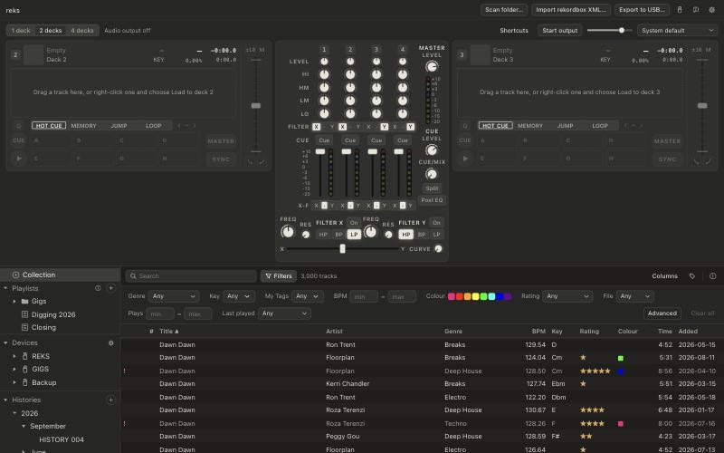
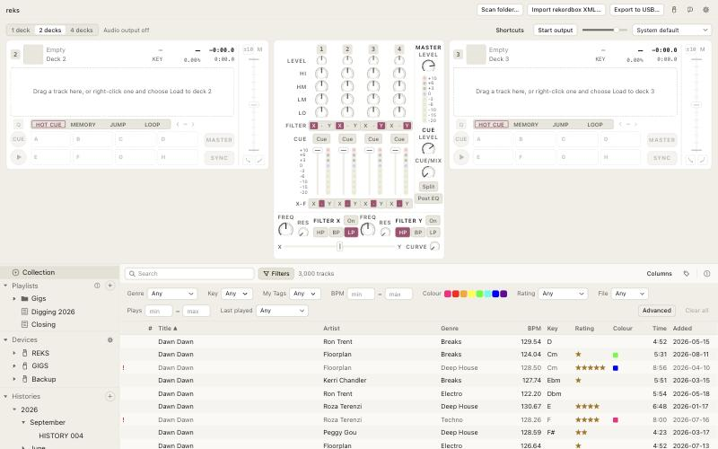

# UI design system

How the React UI is styled. Why this stack: [D26](decisions.md#d26-ui-styling-tailwind-v4--cva--radix).
The look is adapted from a design analysis of Cursor's marketing site (pale
canvas, dark ink, hairline depth, one scarce accent, 8px control radius) at
desktop density, with system fonts. The colours come in five themes, picked in
Settings → Display (`display.theme`); history in
[D26](decisions.md#d26-ui-styling-tailwind-v4--cva--radix):

| Theme | Look | Accent |
|---|---|---|
| Graphite | dark, Claude's warm neutrals | ivory |
| Paper | light, the same warm neutrals | rose |
| Midnight | dark navy | blue |
| Dusk | dark plum | lavender |
| Booth (default) | black, most contrast (dark rooms) | light grey |

No accent is orange, amber, red or green: those already mean something here
(warning/rating and the cue point, danger and memory cues, success and hot
cues, the waveform's mid band), as do the track colours. Every text and button
pair passes WCAG AA in every theme (body text 7:1 or more, filled buttons
3:1 against panels).

## Where things live

| Path | What |
|---|---|
| [`src/styles/tokens.css`](../src/styles/tokens.css) | **The only place that sets the look**: palettes, semantic colours (one block per theme), type, radii, shadow, layers, motion, control sizes, row heights |
| [`src/lib/theme.ts`](../src/lib/theme.ts) | Puts the theme on `<html>` (`data-theme`); `startThemeSync` in `store/settings.ts` calls it when the setting changes |
| [`src/styles/base.css`](../src/styles/base.css) | Our reset (instead of Tailwind preflight) and element defaults (body, `user-select: none` for chrome, focus outline) |
| [`src/styles/index.css`](../src/styles/index.css) | Entry: Tailwind, tokens, base |
| [`src/components/ui/`](../src/components/ui/) | Base components (one per file, each exports its `cva` variants) |
| [`src/components/ui/control.ts`](../src/components/ui/control.ts) | The control size scale and shared focus / disabled / hover states |
| [`src/lib/cn.ts`](../src/lib/cn.ts) | `cn()` = `clsx` + `tailwind-merge`; a later class wins |
| [`src/dev/mockBackend.ts`](../src/dev/mockBackend.ts) | Dev-only stand-in for the Rust commands: `npm run dev` and open the page in a browser to work on the UI without Tauri |

Feature components (`src/components/*.tsx`) do layout and composition only:
utilities for spacing and flex, base components for everything interactive,
semantic colour utilities (`bg-surface`, `text-fg-muted`, `border-border`).
No raw colours or one-off sizes outside `tokens.css`.

## Tokens

Three layers in `tokens.css`:

1. **Primitives** in plain `:root`: one palette per theme (`--graphite-*`,
   `--paper-*`, `--midnight-*`, `--dusk-*`, `--booth-*`) and the shared deck,
   LED, waveform and rekordbox colours (`--red-500`, `--led-*`, `--wave-*`,
   `--rb-*` …). Raw values; no utilities. The only hex values in `src/`.
2. **Semantic tokens** in `@theme static`, in Graphite's colours. These become
   utilities: `--color-surface` → `bg-surface`, `--radius-md` → `rounded-md`,
   `--shadow-overlay` → `shadow-overlay`. Tailwind's default palette, font
   sizes, radii and shadows are dropped, so `bg-blue-500` does not exist.
3. **The other themes**: the semantic colours redefined under
   `:root[data-theme="…"]`. Components never branch on theme. Canvases read
   their colours with `getComputedStyle`, so they re-read them when
   `useTheme()` changes (`mix/DeckWaveform`).

Semantic colours: `bg`, `bg-subtle` (chrome), `row-alt`, `surface`,
`surface-strong`, `hover`, `selected`/`selected-fg`, `knob`, `fg`,
`fg-muted`, `fg-subtle`, `border`, `border-subtle`, `border-strong`,
`accent` (text, lines, focus ring), `accent-solid` (+ `-hover`, `-active`;
filled controls) with `accent-fg` on it, `danger` (+ `-fg`), `success`,
`warning`, `rating`, `focus-ring`, `overlay`, `lit`/`lit-fg` (a switch that
is on, with `shadow-lit`), `led-*` (meter LEDs), `waveform-*`, `track-*`
(rekordbox colours: data, the same in every theme), `theme-*` (each theme's
canvas and accent, for the theme picker). The decks draw
on the `deck`, the theme's darkest panel (Paper's is light, so its
`waveform-high`, `waveform-blue-high`, `led-hot` and `grid-beat` are dark):
`deck`, `deck-fg`, `waveform-low/mid/high` (3-band), `grid-beat`,
`grid-downbeat`, `grid-pin-1` / `grid-pin-2` (grid mode's two points: red,
and the text colour) and `grid-marker` (grid mode's tempo section markers);
the mixer's decks add
`deck-cue`, `deck-hotcue`, `deck-memory`, `deck-loop`, `deck-loop-in` (the pending loop IN), `deck-auto-loop`, `deck-synced` (BPM and tempo % while sync holds the tempo, and the lit SYNC button via `data-lit="synced"`) and the other waveform styles' `waveform-rgb-*` and
`waveform-blue(-high)`. The mark colours are the same in every theme.

The `accent` stays scarce: primary buttons, the loaded track, the played
waveform, focus rings, drop indicators. Selection and toggles that are on
use the neutral `selected` tint, except hardware-style switches in the Mix
panel (`variant="control"`), which light up in `lit` so their state reads at a
glance.

### Common edits (one line each in `tokens.css`)

- A theme's accent: `--color-accent` (text, rings) and `--color-accent-solid`
  (+ `-hover`, `-active`; filled controls) with `--color-accent-fg` on it, plus
  `--color-lit`/`--shadow-lit`, in that theme's block (Graphite's in
  `@theme`). Keep `accent-fg` at 4.5:1 or more on all three solids.
- A new theme: a primitive palette, a `:root[data-theme]` block setting every
  colour the others set, `--color-theme-*` for the picker, the id in
  `THEMES` (`lib/theme.ts`), `Theme` (`ipc.ts`, reks-core `settings.rs`) and
  the picker list in `settings/DisplaySettings.tsx`.
- Control radius: `--radius-md: 8px;` (sizes `md`/`lg` read it via `--ctl-r-*`).
- Height of `md` controls: `--ctl-h-md: 28px;`.
- Row height: `--row-h: 26px;` and `ROW_HEIGHT` in `trackTableModel.ts`
  (the virtualiser needs a number; `tokens.test.ts` fails if they differ).
- Slide timings: `--duration-slide-*` and `--ease-*`, mirrored in
  `src/lib/motion.ts` for tests (also checked by `tokens.test.ts`).
- Flat overlays (no shadow at all): `--shadow-overlay: none;`.

## Reset

`base.css` replaces Tailwind's preflight with a reset of the same intent
(`box-sizing`, zero margins, `border: 0 solid`, form controls inherit the
font, lists unstyled, media block). It leaves out preflight's universal
`::before, ::after, ::backdrop` selectors: they made every track-table row
pay for pseudo-element styles while scrolling (dev build, 20-row scroll
step: p50 8.9 → 8.3 ms). If a component needs a pseudo-element, give it
`before:`/`after:` utilities; nothing resets those.

Measured on the mock library (3,000 rows, 1280×800), production build, per
20-row scroll step including style and layout: p50 1.6 ms before and after
the redesign; p95 3.8–4.0 ms before, 2.5–3.1 ms after.

## Control size scale

Every interactive control takes `size` and reads `--ctl-*-{size}`, so
`Button`, `IconButton`, `Input`, `Select` and `SegmentedControl` of one size
have the same height (tested in `ui.test.tsx`).

| | xs | sm | md | lg |
|---|---|---|---|---|
| height | 20 | 24 | 28 | 32 |
| padding-x | 6 | 8 | 10 | 12 |
| font | 11 | 12 | 13 | 13 |
| icon | 12 | 14 | 16 | 16 |
| radius | 4 | 6 | 8 | 8 |
| gap | 4 | 4 | 6 | 8 |

Use: `xs` inside rows (tree "+", sheet close, key grid); `sm` in bars (app
header, library toolbar, drawers, player bar, decks); `md` (default) in dialogs and
forms; `lg` for large standalone controls. Table and tree rows use `--row-h`,
menu items `--menu-item-h`.

## Components

| Component | Variants / props | Behaviour from |
|---|---|---|
| `Button` | `variant`: primary, secondary, outline, ghost, danger, quiet, link, control (lit when pressed); `size`; `aria-pressed` = toggle | Radix Slot (`asChild`) |
| `IconButton` | as Button (default ghost) + `shape`: square, round; `aria-label` required | Radix Slot |
| `Input` | `variant`: default, search; `size` | native |
| `Textarea` | `size`: sm, md | native |
| `Select` | `size`; native `<select>` with our chevron | native |
| `Switch` | `size`: sm, md; when on, the thumb takes `accent-fg` so it shows on a light accent | Radix Switch |
| `LampButton` | `pressed`; small round text-less toggle (the filter ON lamp), accent when lit; `aria-label` required | none |
| `Checkbox` | `size`: sm, md; `indeterminate` (mixed); native, wrap in a `<label>` (Biome knows it as an input) | native |
| `Slider` | `size`: sm, md; one value | Radix Slider |
| `SegmentedControl` + `Segment` | `size`; `variant`: default, control (chosen segment lit), outline (chosen segment ringed in `accent`, no fill: mode tabs); one choice, can't be cleared (radiogroup); segment corners nest inside the outer radius (`--seg-r`) | Radix ToggleGroup |
| `ChoiceTiles` + `ChoiceTile` | `columns`: 2, 3; tile `label`, `hint` (its accessible description), `preview` (a picture on the `deck` panel), `isDefault` (a Default badge); the chosen tile ringed in `accent` and ticked; one choice, can't be cleared (radiogroup) | Radix ToggleGroup |
| `Tabs` + `TabsList`, `TabsTrigger`, `TabsContent` | `orientation`: horizontal, vertical (a sidebar, Settings); chosen tab in the `selected` tint; arrow keys move between tabs | Radix Tabs |
| `Chip` | label pill (`onRemove`, `removeLabel`; `onActivate` makes it a button); `tone`: neutral, notice | – |
| `Toast` | bottom-centre message with an optional action (Undo); one at a time via `store/toasts` + `ToastHost` | – |
| `Badge` | `variant`: neutral, accent, muted, danger and outline (a ringed word on a row: the Filters drawer's "not" / "all"), warning and success (a check result); `size`: sm, md | – |
| `Kbd` | `variant`: default, inverse | – |
| `Tooltip` | `content`, `shortcut`, `side` | Radix Tooltip |
| Shortcut hint | `Button` / `IconButton` take `shortcut` (+ `hint`, default `aria-label`) and show it in a tooltip on hover/focus; the key text comes from `lib/mixKeys` (`deckKeyHint`, `crossfaderKeyHint`) or `lib/keys` (`PLAYER_PLAY_KEY`), never a literal | `ShortcutTooltip` |
| `DropdownMenu*` | Content, Item (`variant`: default, danger; `inset` lines it up with checkbox items), CheckboxItem, Group / Label, Separator | Radix DropdownMenu |
| `ContextMenu*` | Content, Item, CheckboxItem (`checked="indeterminate"` shows a dash), Sub / SubTrigger / SubContent, Group / Label, Separator; wrap the whole area, not each row | Radix ContextMenu |
| `Popover*` | Content (`align`, `sideOffset`) | Radix Popover |
| `Dialog*` | Content `size`: sm, md, lg, xl (960 px), `closeOnOutsideClick`; Header, Title, Description, Body, Footer | Radix Dialog |
| `Sheet` + `SheetHeader` | right-hand slide-over (non-modal, inside its parent) | Web Animations |
| `ScrollArea` | themed scrollbars; not for the virtualised table | Radix ScrollArea |
| `ResizeHandle` | drag-to-resize edge of its (positioned) parent: `edge`: right, left; `min`, `max`, `value`; arrow keys step 16 px, double-click resets; reports widths, the caller stores them | own (`role="separator"`) |
| `Separator` | `orientation` (decorative) | – |
| `Field` | `orientation`: vertical, horizontal, inline; `active`; `hint`, `error` | – |
| `Card` | `variant`: subtle, surface; `divided` | – |
| `Progress` | `size`: sm, md; native `<progress>` | native |
| `Swatch` | `color` (track colour name) or `style`; `size`: xs, sm, md | – |
| `Caption` | `tone`: muted, subtle, default; small upper-case label | – |
| `Knob` | `size`: sm, md; `bipolar` (arc from the centre), `defaultValue` (double-click / Delete), `lit` (brighter arc and glow), `detent` (a drag crossing it sticks within ±0.03, `knobDragValue`); drag up/down, arrows, Page Up/Down, Home/End | own (`role="slider"`; Radix has no knob) |
| `Fader` | `orientation`: vertical, horizontal; `defaultValue` (double-click the cap or Delete); `detent` (a tick that drags snap to within `--fader-detent`; keys step past it); `ticks` (evenly spaced scale marks, ends included: ends and detent bold, the rest thin and short) | Radix Slider |
| `Pad` + `SplitPad` | deck pads: `tone`: default, set (outlined in `color`, a data colour, else `deck-hotcue`; no fill, `fg` text), empty (dashed), lit; `marked` (heavy outline); `SplitPad`: back / forward halves under one label | – |
| `InlineNumber` | text that becomes a number field on double-click or Enter; Enter / blur commit, Esc cancels, non-numbers are dropped | native |

Settings choices are `ChoiceTiles`: each option carries its own hint, so a
setting's own hint stays one short line, and an on/off setting is a `Switch`
whose hint says why when it is disabled. `SegmentedControl` is for short
in-place choices (pad modes, mixer switches, dialog options).

Menus, popovers, dialogs and tooltips portal to `<body>`; tests query
`screen` / `document`, not the render container.

Performance rule for the track table: rows and cells are plain `div`s with
constant class strings; per-row state is `data-*` attributes styled with
`data-[selected]:…`. No base component, Radix or `cn()` call per cell.

Track table rows come in two densities (Columns menu → Compact rows, saved
in `UiState.rowDensity`): **default** (`--row-h-tall`, 36 px artwork, artist
under the title) and **compact** (`--row-h`, one line). The rows' container
sets `data-density`, which swaps `--row-h` / `--row-art` in tokens.css; the
virtualiser takes the height from `ROW_HEIGHTS`; default rows leave out
the Artist column (`compactOnly`). Clicking a row's artwork previews the
track (`QuickPlayArtwork`) and a click on its waveform previews it from
there, with a playhead, on the engine's preview deck (`PREVIEW_DECK`,
[`preview.ts`](../src/store/preview.ts)), never a mixer deck: it plays in
the headphone cue when the output routes one (the cue level and CUE/MASTER
mix apply), else on the master with the mix faded out over `DUCK_MS`
(300 ms) and back in when it pauses. The **Waveform** column draws each
visible track's whole waveform in the decks' style from `waveform_overview`
(columns squeezed to 400 in Rust, a few KB a row), newest rows first
([`overviews.ts`](../src/store/overviews.ts)), in two lanes: up to four
requests at a time read columns already on disk (`decode: false`: the
columns cache, else reks's analysis `bands.bin`, else the track's mapped
rekordbox `PWV7`/`PWV3` via `reks_anlz::deckwave::entry_columns`;
[`columns::stored_columns`](../crates/reks-analysis/src/columns.rs)), and one
at a time decodes a track that has none, so an unanalysed track never holds
up the rest.

Column edges in the header drag to resize (`ResizeHandle`); a dragged column
keeps its width (`fixed` in `fitColumnWidths`) while the others share the
spare width, and a double-click gives back the default. The sidebar's right
edge and the right-hand drawers' left edge (info panel, My Tags, Filters: one
shared width) resize the same way
([`PanelResizers.tsx`](../src/components/PanelResizers.tsx)), overriding
`--sidebar-w` / `--sheet-w` on the app root. All three are saved in
`UiState` (`columnWidths`, `sidebarWidth`, `sheetWidth`).

Columns that become hidden by default bump `COLUMN_DEFAULTS.version`
([`columns.tsx`](../src/components/columns.tsx)); a saved column list older
than that gets them hidden once (`hiddenColumns` in
[`settings.ts`](../src/store/settings.ts)). Version 1 hid Last played.

### Split track lists

Shift+click a playlist or folder in the tree to open it in a pane under the
track table ([`TrackLists.tsx`](../src/components/TrackLists.tsx)); the lists
stack top to bottom and share the height. With more than one list, each has a
header (name, track count, × to close); closing the main list moves the first
pane up into it. Each pane is its own library store
([`panes.ts`](../src/store/panes.ts)) with its own sort and selection, handed
to `TrackTable` through `LibraryStoreContext`. Search, the Filters drawer
and the info panel stay with the main list. A playlist shows in one
list at a time. Rows dragged from one list onto a playlist pane sorted by
position are added at the drop line. Edits that change rows reach every list
(`allLibraries()`). An (i) on the tree's Playlists row explains all this in a
tooltip.

## Start-up splash

The library opens off the main thread
([`src-tauri/src/startup.rs`](../src-tauri/src/startup.rs)); done in Tauri's
`setup` it blocked the event loop for seconds and the window sat blank white.
Now:

1. The window starts hidden (`"visible": false` in `tauri.conf.json`; the
   window-state plugin leaves visibility alone) and is shown on the page's
   first load, so the native white background never shows.
2. `index.html` holds the splash: the wordmark with a band of light sweeping
   across it ([`splash.css`](../src/styles/splash.css), theme tokens only, so
   it shows in the theme; a slow fade with reduced motion). `main.tsx` puts
   the last launch's theme on `<html>` first (a copy kept in localStorage),
   since the setting itself loads from Rust after the splash.
3. `main.tsx` awaits `appReady()` before mounting React, so no command runs
   before `AppState` exists. App's mount effect fades the splash out
   ([`src/lib/splash.ts`](../src/lib/splash.ts), at least 900 ms on screen so
   it never blinks). If the library cannot be opened, the splash stops and
   shows the reason instead.

## Player (D30)

The library plays on deck 2 of the mix engine ([`src/store/player.ts`](../src/store/player.ts)).
The deck section sits under the app header, above the library, as in
rekordbox and Traktor (2026-10-22; it was along the bottom):

- `PlayerBar`: the section's one toolbar. **1 deck / 2 decks / 4 decks**
  (`Decks shown`): 1 is the player deck alone, 2 and 4 open the Mix panel
  (`panels.mixOpen`, `MixStore.deckCount`). Then the status line: device ·
  rate · buffer · dropouts while the output runs (`outputSummary`), "Opening
  the audio output…", "Audio output off", or the error (failed start, lost
  device; `role="alert"`, the only place errors show). **Start output** /
  **Stop output** (loading a track starts it too). With the Mix panel open,
  **Shortcuts**. A deck that plays out of sight (decks 1/4 with two shown,
  1/3/4 with one) adds a `notice` `Chip`, "Deck 1 playing" (`lib/mixHidden`,
  from the engine state); a click shows 4 decks. Then volume (`MixControl::Volume`, saved as
  `ui.state.volume`) and output device.
- How the output opens is in Settings → Playback (`OutputSettings`), each
  saved: output device (`audio.device`), sample rate (`audio.sample_rate`;
  Automatic = 44.1 kHz when offered), buffer (`audio.buffer_frames`; only
  sizes the device takes) and headphone cue (`audio.cue`; the device's own
  routing until the user picks one, routings it has too few outputs for
  disabled). A change reopens a running output with every loaded deck back
  where it was (`MixStore.setOutput`, `chooseOutput`); a new device goes
  back to its own rate and buffer.
- Under it, `PlayerDeck` (1 deck): deck 2 alone as a `DeckStrip` with
  `solo` (no MASTER, SYNC, phase meter or mixer keys), laid out flat (see
  **Solo** under [Deck layout](#deck-layout-task-16)), with the deck's
  waveforms, cue, pads, nudge, quantise and tempo fader. Empty, it says to
  double-click a track or drag one onto it. On its right, `SoloMixer`
  (task 31, [wireframe](wireframes/one-channel-mixer.html)): channel 2's
  LEVEL and EQ knobs with the legend and the gear, then a column with the
  filter unit (4-band: X in Simple, the assigned one in Advanced with the
  X / · / Y assign above it, none when off or with filters hidden; ON and
  FREQ over RES and the modes, `FilterUnit` `stacked`) or the FX (3-band:
  the select, then the channel FX knob over PARAMETER). As tall as the deck
  (`--deck-solo-h`); the rows share the height. The column is a fixed
  `--solo-mixer-column-w`, so a longer effect name or the other EQ layout
  does not shift the deck. No fader, meter, CUE,
  master or crossfader. When channel 2's fader or the master level is off
  its default, a `notice` chip in the deck's header names the first
  ("Channel 2 fader not up", "+1"; `store/mixDeviations`); a click opens 2
  decks. The deck-2 (left-hand) keys work here too, except SYNC, MASTER and
  the crossfader ([`mixKeys.ts`](../src/lib/mixKeys.ts)). With 2 or 4 decks the Mix panel
  takes its place and shows the same deck among the others; "Load to deck N"
  in the table opens it.
- Double-click or Enter on a row, and double-click in a history session or
  a stick list (Devices, below), load the track on deck 2 and play it (it keeps playing if it already is,
  and replaces a playing track without stopping);
  with 2 or 4 decks they load onto a spare deck instead (see Load under
  [Mix panel](#mix-panel-phase-5));
  loading opens the output when it is off. Space plays and pauses deck 2
  wherever focus is (except in text fields, dialogs and menus). The row of
  the track on deck 2 is marked as loaded.

## Devices (D32)

`DeviceTree` sits between the playlist tree and the Histories in the sidebar
(each of the two lower trees takes at most a third of the sidebar). The store
is [`deviceBrowser.ts`](../src/store/deviceBrowser.ts); everything in it is
read-only.

- Root row "Devices" with a gear that opens the USB devices dialog. While it
  is open, the drive list refreshes every two seconds (`useDevicePolling`), so
  a stick shows up when it is plugged in; a drive that goes away is forgotten
  and its open list closes.
- A drive row (USB icon, eject button on hover) opens to "Playlists" (folders
  and playlists as on the stick) and "Histories" (sessions players logged,
  with a count). Its library is read each time it is opened (after the first
  time the last read stays up meanwhile, so an export shows up); states:
  "Reading…", read error with "Try again", "No rekordbox library on this
  drive", "No playlists", "Not played on a player yet".
- Click a playlist or session (Up/Down with the tree focused) and
  `StickListView` replaces the toolbar and table, as a history session does:
  #, title, artist, genre, BPM, key, time, with a play button per row (hover
  or focus) and double-click to play. Entries whose track the stick no longer
  has show as "Not on the stick". The track on the player deck is marked.
- A drive row's check button (on hover, and while its report is open) shows
  `StickCheckView` in the main area: summary badge (OK / Warnings /
  Problems), library files with their players (UNVERIFIED badge), then the
  findings by section, each group's tracks folded in a `
`. States:
  "Checking every track on the stick…", error with "Try again", "Nothing to
  report". All wording comes from `device_check` (D38); the report store is
  [`stickCheck.ts`](../src/store/stickCheck.ts), what the main area shows is
  `deviceBrowser.checking`.
- Selecting anything in the playlist tree or a library history session closes
  the stick list or report, and the other way round.
- A stick track on a deck is a `TrackRef` of kind `stick` (`mix.ts`): its
  grid and waveform come from `device_beatgrid` / `device_waveform_columns`
  (the stick's own analysis, so both show at once; D32),
  an empty hot cue pad stays dark and cue edits say the cues are the stick's.
- Dev: `npm run dev` serves the REKS stick (and its check report) from
  [`mockBrowse.ts`](../src/dev/mockBrowse.ts).

## Mix panel (phase 5)

[`src/components/mix/`](../src/components/mix/), opened with **2 decks** or
**4 decks** in the player bar, in place of the player deck. Its controls and
status are in the player bar ([Player](#player-d30)), so the panel is the
decks and mixer only, shown whether the output runs or not (2026-10-22; it
had a start form before the output opened). `MixPanel` is the only part that reads the store
([`src/store/mix.ts`](../src/store/mix.ts)); `DeckStrip`, `DeckWaveform`,
`MixerPanel`, `ChannelStrip`, `FilterUnit`, `MasterSection` and `SyncPhase`
take props. The mixer follows the hardware: a channel strip per shown deck (level, HI,
HM (HI MID), LM (LO MID), LO, filter assign X/off/Y, cue, fader, crossfader assign) with
one caption column (it also holds the one dB scale for the channel meters),
the master and cue section, then one row with filter X and Y and a crossfader
across the mixer with its curve at the right end (task 22, 2026-10-23). The
channel numbers are lit badges like the decks'. Decks 1 and 2 sit left of it, 3 and 4 right. Two decks by
default, and they are decks 2 and 3, the centre channels, as with two CDJs
on a 4-channel mixer; 4 with the toggle. With 2 decks the mixer draws
channels 2 and 3 only (task 30, 2026-10-29; `MixerPanel` `shown`, from
`shownDecks`) and is `--mixer-w-two` (264) wide; channels 1 and 4 keep their
positions and still play, and the "Deck 1 playing" chip brings them back with 4
decks. Wireframe: [two-channel-mixer.html](wireframes/two-channel-mixer.html) (A).
Decks are one size in both modes
(two stacked fit beside the mixer); the deck itself is described under
[Deck layout](#deck-layout-task-16).

- States: output off (decks empty or as left, mixer set; loading a track or
  **Start output** opens it, and the mixer's positions reach the engine on
  start), opening, error (failed start, device lost; the decks empty),
  running. Deck states: see
  [Deck layout](#deck-layout-task-16).
- Waveforms draw on the dark `deck`: a scrolling view
  with the playhead in the middle and beat lines, and the overview under it,
  which is the keyboard seek slider. Both draw in device pixels from one
  animation-frame loop (`mix/DeckWaveform`, `mix/deckCanvas`): the waveform
  is cached in tiles on a pixel grid fixed to the track (`lib/waveStrip.ts`)
  and copied at whole-pixel offsets; the playhead runs on between engine
  states (`lib/deckScroll.ts`). Zoom is one level for every deck (so they
  compare at a glance; `MixStore.waveZoom`): 32/16/8/4/2/1/0.5 s across, 8 s by
  default and remembered across launches (`lib/deckZoomMemory.ts`), with − / + on a view, the − / + keys (anywhere outside text
  fields, dialogs and menus, Mix panel open or not; `waveZoomKey` in
  `lib/keys.ts`), or Cmd/Ctrl + scroll.
- Close zoom (2, 1 and 0.5 s across; D40): the scrolling view draws the
  real signed waveform, each device pixel a line from its min to its max,
  uneven about the centre and coloured by band in the chosen style
  (`detailBars` in `lib/waveDraw.ts`). The points (3,000 a second) are built
  by Rust from the loaded deck's audio and fetched in 30 s chunks nearest
  the playhead first (`mix/useDeckDetail`, `lib/deckDetail.ts`); a tile whose
  points have not arrived draws from the columns and is redrawn once from
  the detail when they do. A deck holds at most 20 chunks (10 min), so a
  long mix keeps those near the playhead. 4 s and wider, and the overview,
  stay on the analysis columns.
- Marks (`lib/deckMarks.ts`), on both views: hot cues are a flag with the
  slot letter in the cue's library colour (`deck-hotcue` without one; text
  dark or light by the flag's brightness), memory cues a triangle on the
  bottom edge (`deck-memory` without a colour), the cue point the same in
  `deck-cue`, and an active loop a `deck-loop` band.
  Drag to skim (`mix/useDeckScrub`, a wrapper around `DeckWaveform`, which
  only draws): on the overview the playhead follows the pointer and a press
  jumps there; on the zoomed view the track moves with the pointer (drag
  left to go forward). A playing deck pauses while dragged and plays on from
  the release point. Seeks are throttled to one per 30 ms, the last always sent.
- CUE is held, not clicked (pointer down/up, Enter/Space, and the A/J keys
  down/up): paused on the cue point it previews while held and returns on
  release; PLAY during the preview keeps it playing.
- Tempo range button cycles ±6, ±10 (default), ±16 and WIDE (±100%, labelled `W`; the
  slow end stands still), as on a CDJ-3000.
- SYNC matches beats only, never bars: the DJ decides where in the bar a
  track comes in. (The "Sync aligns: beat / bar" setting was removed
  2026-10-30.)
- Mixer settings (Settings → Mixer, opened by the gear "Mixer settings" in
  the mixer's top-left corner; `setDialogOpen(true, "mixer")` opens on that
  tab and focuses its first control): Mixer view `mix.mixer_view` (**Simple**
  default, Advanced) and the switch "Show filters in the Simple view"
  `mix.mixer_filters` (**Show** default, Hide; disabled, showing what is in
  effect, in Advanced and 3-band). **Simple** hides the FILTER and X-F assign
  rows, the crossfader and the curve; **Filters: Hide** also hides the
  filter row. Hidden controls keep the user's positions in the store, but
  the engine gets `effectiveMix(values, look)` (`lib/mixView.ts`): channels
  1–2 on filter X, 3–4 on Y, crossfader assigns THRU, and with the filters
  hidden both units off. The store sends these on every change, on each
  view switch (`setLook`, fed from settings by `startMixerLookSync`) and at
  start; Advanced sends the user's positions again. X C V do nothing in
  Simple and the Shortcuts list leaves them out (`mixKeyAction(e, decks,
  crossfader)`). Spec: [research §6](research/deck-mixer-layout.md).
- EQ layout (task 27, Settings → Mixer **EQ**, `mix.mixer_eq`: **4-band**
  default, 3-band), for both Mixer views. 3-band rows are LEVEL · HI · MID
  · LOW · FX, and the FX knob has a centre detent and lights outside its
  dead zone (0.485–0.515). The FX row's caption is the FX select
  (`FxControls`, a `CaptionSelect` menu: Filter · Echo · Reverb, each with
  its parameter as a hint), and PARAMETER sits in the legend row under it
  (`--mixer-param-row-h`; the strips leave it empty), a small knob
  captioned Reso / Fdbk / Decay: the full names do not fit the 62 px
  legend and stay in the menu and the knob's label. No X/Y filter row or
  FILTER assigns; Advanced adds
  the X-F assigns and crossfader. Each layout keeps its own EQ positions;
  `effectiveMix` sends the hidden layout's EQ at noon (and FX centred in
  4-band). Filters is disabled outside 4-band Simple. Channel knobs light
  off centre in every layout. Spec:
  [djm-eq-fx.md](research/djm-eq-fx.md) §4–5; wireframes
  [mix-view-56.html](wireframes/mix-view-56.html) and, for the FX select in
  the legend, [fx-select-knob.html](wireframes/fx-select-knob.html) (A).
- Waveform style (Settings → Decks, `display.deck_waveform`), applied to both
  views live, on the player deck too: **RGB** (default since D30; mono height,
  colour mixed from `waveform-rgb-low/mid/high` by band level), **3-band**
  (low/mid/high overlaid, `waveform-low/mid/high`) and **Blue** (mono height in `waveform-blue`, lightening to
  `waveform-blue-high` as highs dominate). All three come from the same
  analysis columns (close zoom: from the deck's detail, where 3-band mixes
  its band colours into one line like RGB); drawing is pure in
  [`waveDraw.ts`](../src/lib/waveDraw.ts) (`waveBars`, `detailBars`). Only styles our columns can feed are offered.
- Sync phase: a marker half a beat either side,
  green within 1/32 beat. The tempo fader is CDJ-style: faster towards the
  bottom.
- Load: the table's context menu ("Load to deck N", also in playlist views)
  or drag a track onto a deck. Loading starts the output if it is off.
  Double-click or Enter loads paused onto a spare deck: an empty one first,
  else the lowest-numbered deck shown that is stopped with its channel fader
  fully closed ([`spareDeck.ts`](../src/lib/spareDeck.ts)). A deck that may
  be on air is never replaced: with none spare, a toast says "No free deck".
- Shortcuts while the panel is open ([`src/lib/mixKeys.ts`](../src/lib/mixKeys.ts),
  also under **Shortcuts** in the player bar): the table under
  [Deck layout](#deck-layout-task-16). Every deck control with a key shows
  it in its tooltip (`deckKeyHint`, from the same table as the handler).
- The mixer is memoised away from the 60 Hz engine state; only the decks
  re-render with it.
- Meters (`ui/Meter`): a DJM-style column of nine round LEDs on the deck
  colour, labelled beside them: +10 red, +6/+3 white, 0 blue, −3…−20 lime
  (`led-*` tokens). The scale is `src/lib/meterScale.ts`: +10 is 0 dBFS, so 0
  (blue) is −10 dBFS (our calibration, UNVERIFIED against a DJM). The red LED
  also lights while a clip is held (1 s; the engine reports a clip once).
  Each meter subscribes to its own lit-LED count (`useMeter`,
  `mix/LiveMeter`), so it renders only when an LED changes and the memoised
  mixer still skips the 60 Hz renders.
- Mixer switches (CUE, SPLIT, POST EQ) are
  `Button variant="control"` and the assign switches `SegmentedControl
  variant="control"`: when on they are lit (`lit` fill, `lit-fg` text,
  `shadow-lit` glow), the same look for every hardware-style switch.
  A filter unit's ON and HP / BP / LP are `LampButton`s, bottom-aligned with
  its knobs: from the mixer's edge inwards ON (captioned X or Y), FREQ, RES,
  then the modes as a column, HP / BP / LP top to bottom on both units, so
  the middle of the row stays clear.
  HP / BP / LP and channel CUE: a click picks one, Shift+click combines
  (tooltip on each); FILTER assign starts at X for channels 1–2, Y for 3–4.
- Knobs draw a position mark (`knobMark`, `--color-knob-mark`: dark ink on the light cap in every theme).
- Mixer height per view (task 25): Advanced 440, Simple 356, Simple with
  the filters hidden 292 (`--mixer-h-advanced` / `-simple` / `-simple-bare`);
  3-band Simple 333, 3-band Advanced 393 (`--mixer-h-three` /
  `-three-advanced`). Spare height spreads the rows.
  The Mix panel's `data-mixer` picks one (`mixerSize`) and re-declares
  `--deck-h`, which a `var()` on `:root` would not follow. With 4 decks the
  mixer stays 440 and its faders (`--fader-len`) and the master meter take
  the difference, 60 px at most (`--fader-bonus`; 47 in 3-band Advanced). In Simple the master
  meter has no dB labels and fills the row.
- Sizes (mixer 344 × 440, `--mixer-w` × `--mixer-h`, 264 wide with 2 decks; strips 52, rows 26, faders 96,
  filter FREQ `--knob-lg` 32, filter unit gaps `--mixer-filter-gap` 8, 4 with 2 decks;  ):
  `--knob-*`, `--fader-*`, `--meter-w`, `--meter-dot`, `--meter-label-*`, `--deck-*`, `--pad-h`,
  `--mixer-*`, `--mix-panel-max-h` (window height − `--app-chrome-h` − `--library-min-h`, so the library keeps 4+ rows and the panel does not scroll at 1280 × 800).

### Deck layout (task 16)

[Phase 5 task 16](phases/phase-5.md), approved 2026-10-22, built the same day.
Modelled on rekordbox's 2Deck Horizontal. Approved wireframe:
<https://claude.ai/artifact/1bLg3dZwjRfL4nXbYvFdzD> (revision 3).

**Size** (task 23). 2 decks: `--deck-h` = `--mixer-h` (440 px in Advanced; 356 / 292 in the Simple views, so the decks follow the mixer); the waveform takes the spare height (`--deck-wave-min-h` 60 is the floor). 4 decks (`compact`): `--deck-h-compact` 216 px, two stacked make the mixer's
440; header 30 (artwork 24), overview 14, waveform 60. Both have the same controls row (below). The panel is capped by
`--mix-panel-max-h` = window height − `--app-chrome-h` (82) − `--library-min-h` (246: toolbar and filters 116, column
header, 4 rows). Width is what's left on each side: with 4 decks 448 px at a 1280 px window (minimum `--deck-min-w` 440),
528 at 1440, 768 at 1920; with 2 decks (narrower mixer) 488, 568 and 808.

**Controls row** (2026-10-23), left to right: Q over CUE and PLAY · pad mode tabs over the 2 × 4 pads · the quick-loop
block (BEAT | IN/OUT tabs over one page) · MASTER over SYNC. One CSS grid (`--deck-ctl-cols`); every column has the
same three rows (`--deck-ctl-rows`: the tabs' 20 px, then one row per pad row), so Q and the loop page tabs sit level
with the pad tabs and CUE, the loop size (or IN OUT), MASTER level with the first pad row. The deck section is an inline-size container
(`data-deck-size` = `mix` / `compact` / `solo`, rules in `tokens.css`) and the row scales with its width (`clamp()` on
`cqw`): height 92–116 px on 2 decks (80 on 4), loop block 100–148, MASTER / SYNC 52–88, gaps 4–10; CUE and PLAY are
round, one pad row across; the pads take the rest. Below 30rem (a 1280 px window) the deck's 2xs labels drop to 10 px
and the page picker hides its page count, so RELOOP, MASTER and the tabs fit.

| Window | Deck | Row columns 2 decks (CUE · pads · loop · sync) | 4 decks | Pad (2 / 4 decks) |
|---|---|---|---|---|
| 1280 × 800 | 448 | 32 · 170 · 100 · 52 | 26 · 176 · 100 · 52 | 40 × 32 / 42 × 26 |
| 1440 × 900 | 528 | 32 · 235 · 107 · 56 | 26 · 241 · 107 · 56 | – |
| 1920 × 1080 | 768 | 44 · 393 · 143 · 83 | 26 · 411 · 143 · 83 | 95 × 44 / 99 × 26 |

Measured in the dev mock (headless, Dawn Dawn loaded on deck 2; dark and light give the same numbers; library rows =
`(grid height − header) / 26`, whole rows):

| Window | Mix panel (2 / 4 decks) | Panel scrolls | Library rows 2 / 4 decks | Deck-2 waveform 2 / 4 decks |
|---|---|---|---|---|
| 1280 × 800 | 448 / 448 | no | 5 / 5 | 369 × 222 / 369 × 60 |
| 1440 × 900 | 448 / 448 | no | 8 / 8 | 449 × 222 / 449 × 60 |
| 1920 × 1080 | 448 / 448 | no | 17 / 17 | 689 × 222 / 689 × 60 |

(Before: 501 / 536 px, 3 library rows at 1280 × 800, the 4-deck panel scrolling; 1 deck is unchanged, 15 / 19 / 27 rows.)

**Rows**, top to bottom, with the tempo column down the right edge:

| Row | Contents |
|---|---|
| Header (40 px; 30 compact) | Deck number (lit when loaded) · artwork (eject ⏏ on hover or focus; dashed box without artwork) · title / artist · key (in the Settings notation; a readout with KEY under it, not a pill) · BPM with tempo % under it (both in `deck-synced` while sync holds the deck at the master's tempo: the fader does nothing) · remaining over elapsed time |
| Zoomed waveform (spare height, min 60 px; the player deck 72 px) | Playhead centred, beat lines, hot cue and loop markers, sync phase meter on the top edge when synced. Zoom − / + float top right on hover or focus-within, zoom level between them. Drag to skim |
| Overview (20 px; 14 compact) | Whole track, played part shaded, hot cue ticks in cue colour, cue point, loop bar. Keyboard seek slider |
| Controls (see Controls row) | Q over CUE and PLAY (round) · pad mode (HOT CUE / MEMORY / JUMP / LOOP: equal tabs, the chosen one outlined in `accent`) · page ◀ ▶ (JUMP, LOOP, MEMORY; disabled in HOT CUE so nothing shifts) · 2 × 4 pads · `LoopBlock` (see [Quick loop](#quick-loop-task-21)) · MASTER over SYNC |
| Tempo column (44 px) | Range button (±6 / ±10 / ±16 / W, for WIDE) and **M** (master tempo: key lock, lit when on) · full-height fader · nudge |

- **BPM edit**: double-click (or Enter when focused) turns the BPM into a
  number field; Enter or blur saves, Esc cancels. Tempo = typed ÷ the
  track's BPM at the playhead; out of range, the range steps up to the
  smallest that fits. Disabled without a grid and while synced.
- **Tempo fader**: scale marks, bold at both ends and at 0 %, thin between: 13 on the mixer decks, 7 on the shorter player deck; detent at 0 % that drags snap to within `--fader-detent`;
  double-click or Delete resets. No Reset button.
- **Nudge**: the CDJ jog-wheel arrows, two arcs of the wheel's lower rim
  pointing down: left (− REV, anticlockwise) slows, right (+ FWD,
  clockwise) speeds up. Held.
- **MASTER** is lit while the deck is master; a click takes master. SYNC as
  before; in BPM sync (a nudge, FINE jump or part-beat jump left the
  master's phase) it reads BPM, and a press returns to beat sync. The
  phase meter shows on synced decks other than the master.
- **Pads** (pad mode is a tab strip: `SegmentedControl` `variant="outline"`, four equal tabs, the chosen one outlined like the set hot cues; lit is for switches like Q, not modes; same 2 × 4 in every mode; ◀ ▶ page through sizes in BEAT JUMP
  and BEAT LOOP, and through the memory cues in MEMORY; HOT CUE shows them disabled at 1/1 so the row doesn't shift; with the pads under 20rem the labels read CUE / MEM):
  - HOT CUE: A–H, a set pad outlined in its cue's colour (`HotCueView.color`,
    else `deck-hotcue`) and its name; empty pads dashed. See
    [Cue editing](#cue-editing-task-17).
  - MEMORY (added 2026-10-22, maintainer's request): the first eight
    memory cues by position per page (`MEMORY_PADS`), shown
    like hot cues: outlined in the cue's colour (else `deck-memory`), the
    time, LOOP or AUTO on a memory loop, and the name. Click calls the cue,
    double-click renames, × or Shift+click deletes, right-click toggles
    AUTO on a memory loop; an empty pad sets a memory cue at the playhead;
    ◀ ▶ page through them eight at a time. T / Y cycle HOT CUE → MEMORY → JUMP → LOOP.
  - BEAT JUMP: page 1 FINE (1/32 beat), 1/8, 1/4, 1/2, 1, 2, 4, 8; page 2
    1 … 128. Split pads: left half ◀ back, right half ▶ forward. Jumps keep
    the beat phase while playing.
  - BEAT LOOP (rekordbox's sizes): page 1 1/64 … 2, page 2 4 … 512 (opens on
    page 2, where the default 4 is). A pad sets a loop from the
    playhead (quantised) or resizes the active one (halved / doubled to the
    size, start kept: `loopPadControls`); the active size is lit and pressing
    it again exits.
  - The size used last (jump and loop, default 4) has a heavy outline and
    carries the E/R and F hints; the keys use it. Pad mode, pages and sizes
    are kept per deck across loads.
- **Solo** (player deck, full window width): no MASTER or SYNC. The header
  stays on top; under it one row holds CUE / PLAY, the two views and the
  pads (336 px; they grow to the views' height), so the deck is
  `--deck-solo-h` (162 px) instead of 260. The views get the width that is
  left (953 px at 1440, 310 at the 800 px minimum window).
- **States**, each at full size with disabled controls rather than hidden
  ones: empty (how to load in the waveform slot), loading ("Decoding…"),
  analysing (playable; BPM, MASTER, SYNC, Q, jumps and loops wait for the
  grid), no grid (warning inside the waveform's bottom edge), playing,
  synced / looping, error (reason with Retry and Eject in the waveform slot;
  a waveform-only failure keeps the deck playing and offers Retry only).
- **Analysis on load**: a track whose grid is empty is queued for analysis
  (`analysisReanalyse`). When the `analysed` event arrives the deck refetches
  waveform and grid; the engine only takes a grid at load, so a paused deck
  is reloaded in place at once (cue point, position and tempo put back) and
  a playing one at its next pause, saying so on the waveform meanwhile.

**Components** ([`src/components/mix/`](../src/components/mix/)). `MixPanel`
and `PlayerDeck` stay the only store readers. `DeckStrip` (layout, drop
target, which state shows) composes one file per part: `DeckHeader`
(`ui/Artwork`, `InlineNumber` for the BPM), `DeckWaveform` (both views:
they share one animation-frame loop, so the overview is not a file of its
own) with `DeckWaveformRow` as its overlay (zoom buttons and level,
`SyncPhase`, the warning line), `DeckSlot` (empty / loading / analysing /
error), `DeckTransport`, `DeckPads` (`SegmentedControl` tabs,
Q, `PagePicker`, `Pad` / `SplitPad`), `DeckSyncButtons`, `DeckTempo`; `hold.ts`
gives CUE and nudge their held handlers. Shared pieces: `ui/Pad.tsx`,
`ui/InlineNumber.tsx`, `Fader` `detent`, `ui/Artwork` + `useArtworkUrl`
(shared with `TrackDetailPanel`), `NudgeDownIcon` / `NudgeUpIcon`. Controls
with a key show it in their tooltip (`shortcut` from `deckKeyHint()`).

**Data.** `DeckMeta`: `padMode`, `padPage`, `lastJump`, `lastLoop`,
`analysing`, `gridPending`, `failed` (for Retry); `DeckTrack.key`,
`artworkId`, `artworkMime` (from `library_track` on load); `HotCueView.id` /
`MemoryCueView.id` and `name` (task 17); `HotCueView.colorRgb`
(task 15) and `name` (from `Cue.name`, through `mix_load`). From tasks 13 and
15: `DeckView.loopRegion`, `master`, beat jump / loop / loop exit / resize /
take-master controls; task 15's per-deck zoom became one `MixStore.waveZoom`
(maintainer, 2026-10-22). Pure helpers in `mixView.ts`:
`JUMP_PAGES`, `LOOP_PAGES` (FINE = a 1/32 `beatJump`; the engine's 10 ms
`fineJump` is unused by the deck), `formatBeats`, `snapToDetent`,
`tempoForBpm`, `nextPadMode`, `loopPadControls`. Tokens: `--deck-h` (= `--mixer-h`), `--deck-h-compact` 216,
`--deck-header-h` 40 / `-compact` 30, `--deck-min-w` 440, `--deck-wave-h` 72 (player deck), `--deck-wave-min-h` 60,
`--deck-overview-h` 20 / `-compact` 14, `--deck-views-h`, `--deck-solo-h`, `--deck-art` 40 / `-compact` 24,
`--deck-pads-max-w` 336 (player deck), `--deck-controls-h-compact` 80, `--deck-ctl-rows`; scaled per deck
(`[data-deck-size]`): `--deck-controls-h`, `--deck-pad-row-h`, `--deck-transport-w`, `--loop-block-w`, `--deck-sync-w`,
`--deck-gap`, `--deck-ctl-cols`; `--deck-tempo-w`, `--pad-h` 26, `--fader-detent` 6.

**Keys** follow rekordbox's default PERFORMANCE keys (Performance 1,
[rekordbox 7.0.5 shortcut reference](https://cdn.rekordbox.com/files/20241203185020/rekordbox7.0.5_default_keyboard_shortcut_reference_EN.pdf))
so the same fingers work in both. Left hand deck 2, right hand deck 3;
Option (⌥) adds decks 1 / 4 with four shown (rekordbox's decks 3 / 4).
Shift is a key's second function, ⌘ (or Ctrl) its third:

| Action | Left | Right |
|---|---|---|
| Cue (hold), play below it | A, Z | H, N |
| Sync · take master | Q · Shift Q | Y · Shift Y |
| Nudge slower / faster (hold) | W E | U I |
| Hot cues A–D (any pad mode) | 1–4 | 6–9 |
| Previous / next memory cue | R T | O P |
| Set memory cue at the playhead | Shift T | Shift P |
| Beat jump back / forward, last jump size | ⌘ R, ⌘ T | ⌘ O, ⌘ P |
| Loop on / off, next loop size (rekordbox: auto beat loop) | Shift F | Shift L |
| Loop IN · OUT (rekordbox: Loop In / Out) | D · F | K · L |
| Reloop, or leave the loop (rekordbox: Exit / Reloop) | G | ; |
| Halve · double the loop, or the next loop size (rekordbox: Halve / Double) | Shift D · Shift G | Shift K · Shift ; |
| Next pad mode (no rekordbox key) | Shift S | Shift J |

Crossfader X / C / V (rekordbox has none; it puts sampler slots there),
Space (player deck) and waveform zoom − / + (every deck at once, also
with the Mix panel closed) are not per deck. rekordbox keys we have no
action for yet stay free: slip reverse (S, J), return to start, tempo. Mouse or Tab
only: hot cues E–H, other pads, page arrows, Q, M, tempo range, BPM edit,
eject, the memory cue list, renames.

### Quick loop (task 21)

[Phase 5 task 21](phases/phase-5.md), spec
[`research/deck-mixer-layout.md`](research/deck-mixer-layout.md) §5; laid out
like rekordbox's since task 28 (wireframe
[`wireframes/loop-control.html`](wireframes/loop-control.html), option B).
`mix/LoopBlock` is on every deck in every pad mode, from `Button
variant="control"` and the `SegmentedControl` the pad mode tabs use. It is
`--loop-block-w` wide: BEAT | IN/OUT tabs level with the pad tabs, then one
page over the two pad rows. The page is kept per deck across loads
(`DeckMeta.loopPage`, default BEAT). Right of the pads on the mixer decks, between the
waveform and the pads on the player deck.

| Page | Control | Not looping | Looping (lit) |
|---|---|---|---|
| BEAT | size | the next size (`DeckMeta.lastLoop`); click loops that size (needs a grid) | the loop's length (`64`, `1/16`, `3.87`, or `1.25s` without a grid); click leaves it |
| BEAT | ‹ › | halve / double the next size (1/64 … 512; needs a grid) | resize the loop (by time without a grid); a beat loop's new size stays the next size after EXIT |
| IN/OUT | IN | pending loop IN at the playhead; lit, and drawn on both waveforms (`deck-loop-in`) | moves the loop's start |
| IN/OUT | OUT | loops from a pending IN to the playhead; disabled until the head is past IN | moves the loop's end |
| IN/OUT | RELOOP / EXIT | RELOOP: back into the last loop; disabled when there is none | EXIT: leaves it, keeping it |

The keys don't depend on the page. State and format are pure in
`mixView.ts` (`loopBlockState`, `stepLoopSize`, `formatLoopBeats`,
`formatLoopSeconds`); `DeckStrip` passes them to the block. A memory loop
pad sends its end with `callCue`, which arms RELOOP. Keys and tooltips come
from `mixKeys.ts`; `ShortcutHelp` is built from the same table
(`deckKeysHelp`). UNVERIFIED on a CDJ (hardware checks deferred).

### Cue editing (task 17)

[Phase 5 task 17](phases/phase-5.md). Every edit is written to the track's
cues in the library first (`mix_cue_edit` → `reks-core` `cue.rs`), so it
shows in the track's details and reaches the rekordbox XML and USB exports;
the command returns the deck's cues and the store takes them.

- **Hot cue pads** (HOT CUE mode, and keys 1–4 / 7–0): an empty (dashed)
  pad sets its cue at the playhead (on the nearest beat with Q) in the next
  colour of `HOT_CUE_PALETTE` (green, blue, red, yellow, purple, cyan,
  orange, pink: rekordbox palette entries, so each exports as itself); a
  set pad jumps as before. Double-click a set pad to rename it in place
  (`InlineTextField`; Enter saves, Esc cancels, blank clears; up to 64
  characters). The double-click's first click still triggers the cue, as a
  click does. Delete with the pad's × (shown on hover or focus; a real
  button after the pad in the Tab order) or Shift+click. The pad's tooltip
  says all of this.
- **Memory cues and loops** live on the MEMORY pads (`DeckPads`
  `MemoryPads`), eight per page with ◀ page ▶ like JUMP and LOOP (the
  page is not kept per deck; it follows the track's cues). An empty pad
  (or Alt A / Alt J) sets a memory cue at the playhead (on the beat with
  Q), or, while a loop plays, saves that loop as a memory loop; a second
  press at the same place adds nothing. A pad calls its cue; double-click
  renames; × or Shift+click deletes; right-click has Jump here, Rename,
  **Auto loop** (memory loops: playback enters it by itself when the
  playhead reaches its start, rekordbox's active loop) and Delete. Alt E R
  / Alt O P call the cue before / after the playhead. A call moves the cue
  point and the playhead there exactly; a playing deck plays on
  (rekordbox's memory list; a CDJ's CALL is UNVERIFIED). There is no + or
  count button and no list (2026-10-22, maintainer's call).
- **Marks**: a memory loop draws a bar along the bottom edge to its end
  and a short end line; an AUTO loop draws both in `deck-auto-loop`, the
  bar thicker. Hovering a mark on either waveform names it ("Hot cue A:
  Drop", "Memory cue", "Memory loop", "Auto loop", "Cue point"; native
  title, `markAt` / `markTitle` in `lib/deckMarks.ts`).
- **Export**: AUTO loops reach a USB stick only with **Active loops**
  (UNVERIFIED badge, off by default) in the export wizard; see phase 5
  task 17.
- Shared pieces: `ui/InlineText.tsx` (`InlineText`, `InlineTextField`);
  `Pad` shows its `hint` in a tooltip even without a key and takes
  `remove` (the corner ×); hint tooltips are
  not hoverable (`disableHoverableContent`), so one flipped over the
  controls above its trigger closes as the pointer leaves and never takes
  their click.

## My Tags

Two-level tags (category → tag, `tag.rs`). The store
([`src/store/tags.ts`](../src/store/tags.ts)) holds the tree and runs every
edit through `tags_mutate`; assigning patches the loaded table rows in place
(selection and scroll stay, so several tags can be ticked in a row); deleting,
merging and any edit that rewrote comments (`commentsUpdated`, write-back on)
re-query. Pure helpers (coverage, search, create offers) are in
[`tagModel.ts`](../src/store/tagModel.ts).

- `FilterDrawer`: the library filters in a `Sheet`, same header and Escape/×
  close as My Tags; the toolbar Filters button (on the right, by My Tags and
  Track info, the drawers' side) toggles it (hidden by default).
- `TagDrawer`: a `Sheet` on the right, over the info panel (and sharing the
  spot with `FilterDrawer`: opening one closes the other; toolbar tag
  button, "Manage tags…", the info panel's "Edit
  tags"). Attach and manage in one place: a checkbox per tag for the main
  list's selection, following it live (`tagTargets.ts`; mixed when only some
  tracks have it; no checkboxes with nothing selected), names shown as text that a click turns into a field
  (`InlineText` `editOn="click"`), drag a row's grip to reorder
  (`useTagDnd.ts`; a tag dropped on another category's tag or header moves
  there, categories reorder among themselves; `dropMove` in `tagModel.ts`
  turns the drop into a `move`; mouse only), × per row deletes after a
  confirmation, add rows; a tag added while
  tracks are selected is attached to them. `move` positions count the node
  where it still is (reks-core). Escape or × closes it; the info button
  brings the info panel back to the front.
  Under the header, "Read from Comments…" and "Clean up…" open the organizer.
- `TagOrganizer` (D39, [`store/tagOrganizer.ts`](../src/store/tagOrganizer.ts),
  pure helpers in [`tagOrganizerModel.ts`](../src/store/tagOrganizerModel.ts)):
  "Read from Comments…" first asks in a `ConfirmDialog` with the counts
  (tracks, names, new); the organizer `Dialog` then shows the tags read ("Just
  read" / "All tags" toggle; "Clean up…" and the import report open it too).
  "Possible duplicates" lists `tags_duplicates` groups with a Keep select (the
  tag on most tracks by default) and Merge. Below, tags by category: tick,
  rename on click, track count, category select (moves at once). The toolbar
  under the list acts on the ticked tags: Move to…, Move to a new category,
  Merge… (pick the one to keep), Delete… (with the track count). States:
  counting, nothing to read, loading, load error with Retry, no duplicates,
  no tags.
- Import wizard: when comments carry blocks, a checkbox (on) "Import My Tags
  from Comments" with the counts; the report shows tags created / assigned
  and "Organize tags…".
- Settings → Library: "Write My Tags to Comments" switch (`TagSettings`);
  when on, the count of tagged tracks whose block differs and "Update now"
  (`useCommentSync`).
- `TagSubmenu`: "My Tags" in the track context menu. One checkbox per tag
  for the whole selection; a tag only some selected tracks have is mixed and a
  click adds it to all; the menu stays open; the search field offers
  "Create 'X' in <category>".
- `TagPicker` (Popover body, search + checkboxes by category): the tag drawer
  and context menu's body. The Filters drawer has one row per category instead
  (see below).
- `TrackTags`: the info panel's removable chips and the "Edit tags" button.
- "My Tags" table column, hidden until switched on.
- States: loading, load error with Retry, no tags in a category (its add field
  is always there), no match for the search.
- Dev: `npm run dev` serves tags from [`mockTags.ts`](../src/dev/mockTags.ts).

## Track info panel and bulk edit

The info panel (`TrackInfoPanel`, `InfoPanel.tsx` is its frame) shows the
primary selected track (`TrackDetailPanel`: one form, Save/Revert, Escape
reverts) and, from two selected rows on, `BulkEditPanel` instead. The bulk
form edits what is safe on many tracks: artist, album, genre, label, year,
rating, colour, key, comment and My Tags; title, BPM, grid, cues and path are
left out.

- A field where the tracks differ shows **Mixed** (placeholder, or a hidden
  "Mixed" option in the rating and colour selects) and is untouched until
  changed. Typing back the shared value untouches it again
  ([`bulkEditForm.ts`](../src/components/bulkEditForm.ts), pure).
- **Comment**: a segmented control, "Replace comment" or "Append to comment";
  nothing is edited until text is typed.
- **My Tags**: the `TagPicker` body inline. A click adds the tag to all (or
  removes it from all when every track has it); a second click undoes the
  click; the box is a dash when only some tracks have it.
- The primary button reads "Apply to N tracks", N being the tracks that would
  actually change. One call (`library_bulk_update_tracks`) writes everything
  in one transaction. 20 or more tracks open a confirmation naming the fields
  ("cannot be undone"). Discard or Escape drops the edits. Changing the
  selection starts a fresh form.
- The selection is resolved with `useSelectedTracks`, which loads the pages a
  selection spans (select-all over several pages); the panel says "Loading N
  selected tracks…" meanwhile.
- States: loading, load error, nothing but dividers selected, the form, apply
  error (the form stays), saving.

## Filters drawer and smart playlists (D35)

One query, edited in the Filters drawer ([wireframe](wireframes/filters-drawer.html),
concept A): rows on a rail, ANDed until you ask for OR. It narrows whatever the
tree shows (the chosen playlist is `library.playlistId`, outside the drawer).
State is [`store/rules.ts`](../src/store/rules.ts); the draft and every edit are
pure functions in [`ruleTree.ts`](../src/store/ruleTree.ts). `toRule` turns
the rows that filter into the `RuleNode` that `library.rule` sends with every
query (D29), only while the Filters switch is on.

Components: `FilterDrawer` (chrome, banners, Clear all, save) → `RuleBuilder`
(reads the stores, the root level, "+ Add filter") → `RuleLevel` / nested
group card (`RuleGroup.tsx`) → `RuleRow` → `RuleValueEditor`, with
`FieldChooser` (Add filter: search over fields and values) and `ValuePicker` (`PickerPopover`,
`ListPicker`: the operator on top, a checklist with search, count and Clear,
and loading / error-with-Retry / empty states). All but `RuleBuilder` and
`FilterDrawer` take props. Sizes: `--query-rail-w`, `--query-dot`,
`--query-label-w`, `--query-row-h`.

- **Default fields**: BPM, Key, Genre, Rating and the first My Tags category
  are rows from the start, empty ("Any"); an empty row filters nothing. The
  list is the user's: the row menu's "Keep in default fields", and "Reset
  default fields" under Add filter. Stored in settings `ui.state.filterFields`
  (`bpm`, `key`, …, `tag:<category id>`; `null` = built in). A default row
  removed stays out until the next fresh drawer (Clear all).
- **One row per field per level**; each My Tags category is a field of its
  own (marked `#`), any / all / none of its tags, so categories AND. Add
  filter greys the fields shown on the level ("shown") and jumps to their row.
  A default field used anywhere in the query (say inside a group) shows no
  extra empty row; it comes back when that use goes. Repeats only inside groups.
- **Order**: an added row goes after the last row on its level that isn't an
  unused default, so what filters stays at the top; default rows keep their
  place when set (`insertIndex`).
- **Operators in the pickers**: lists (Genre, Key, Colour, Playlist) Any of /
  None of (= Exclude); a tag category also All of (a blue "all" mark; "not"
  is red); Rating at least / exactly / at most; BPM and Plays two inputs,
  either side optional; Last played never / since a date (no relative "last
  N days"); File missing / present. Lists of more than one value are an "any"
  group of single filters; tags "all" an "all" group of one-tag `tagAny`s;
  rating at most / exactly are `ratingMin` with `not` / combined. `fromRule`
  reads these shapes back as the same rows (no core change).
- **Rail and connectors**: "and" / "or" between rows; a click switches the
  whole level (no mixed and/or on one level). Lit while both sides filter.
- **Row menu** (`···`, or Shift+F10 on the row): Or… (wraps the row in an
  "any" group with an empty row whose field list opens; in a group that
  already reads "or" it just adds the row; three levels at most), Exclude,
  Pause (kept, dashed and struck through, left out of `toRule`), Keep in
  default fields, Remove. × on a set row empties a default row or removes
  an added one. Group header: Any / All / None of these, Ungroup, Remove
  group; "+ Or…" adds an alternative.
- **Keyboard**: the row's dot on the rail is its handle: ↑ / ↓ between rows,
  Enter opens the value (or focuses a range's minimum), Space pauses,
  Backspace / Delete empties a set row or removes an empty one, Shift+F10 the
  menu. A row just added takes focus with its picker open. `/` anywhere in
  the drawer outside a text field opens the root Add filter
  (`rules.addOpen`).
- **Add filter search** (`FieldChooser`, matching in
  [`filterSearch.ts`](../src/store/filterSearch.ts)): a combobox (focus stays
  in the search box, ↑ / ↓ / Home / End move, Enter picks, options are
  `aria-activedescendant`). Blank, it lists the fields by group; typed, it
  lists values first: a number 40–300 is "BPM around" it ± 2
  (`BPM_SEARCH_TOLERANCE`), "4*" / "4 stars" / "★★★★" a rating at least,
  a key typed exactly in any notation (shown in the user's), then genres and
  tags (with their category) by name, starting matches first, eight at most;
  then fields whose name matches. A value on the root level sets or extends
  its field's row like a quick path (`addValue` → `fillRow`); in a group it
  adds a row there; on a row waiting for its field it sets that row.
- **No count or summary in the drawer**: the table shows both. The Filters
  button's badge counts the rows that filter (`activeRowCount`); its tooltip
  has the one-line `summarize` text. No Apply button: edits re-query after
  50 ms and only when the rule changed.
- **States**: off (rows dimmed but editable, a banner "Filters are set aside.
  N kept." with Turn on), nothing left on the root level ("No filters here"),
  pickers loading / error with Retry (genres, keys and colours from
  `library_facets`, `facetsError`; tags from the tag store), an empty group,
  no match (`EmptyResult`: "Undo last change" back to the last draft whose
  result had tracks, and "Clear filters").
- **Clear all** empties the drawer to the default fields with one Undo toast;
  the shown playlist stays.
- **Quick paths** fill rows: a tag chip's label ("Filter by tag X") fills
  that tag's category row; a playlist's "Show tracks not in this playlist"
  fills a Playlist row with None of (`fillRow`). Both open the drawer.
- **Saved filters** (D35; list in
  [`filterPresets.ts`](../src/store/filterPresets.ts), the loaded one in
  `rules.preset`): `SavedFiltersPicker` under the drawer's title names the
  loaded one ("Saved filters" when none) and opens a list: a click loads it
  (the drawer is replaced and filters turn on; an Undo toast brings back a
  drawer that held something), hovering shows its `summarize` text, each has
  Rename (in place), Duplicate, Move up / down and Delete (Undo toast
  re-creates it in its place), rows drag to reorder, a search field from 9
  on. States: loading, error with Retry, none yet, no match, a rule a newer
  reks wrote (refused with a toast). A loaded one that no longer matches the
  drawer shows **edited** and a banner with **Update** (`setRule`) and
  **Revert**; nothing auto-saves. Clear all unloads it (its Undo loads it
  again); renamed or deleted elsewhere, the name follows or goes (the rows
  stay). The toolbar's ▾ next to Filters (or ↓ on the Filters button) lists
  them too, with Show / Hide filters.
- **Save…** (`SaveFilterDialog`): a name suggested from the rows
  (`suggestName`: "Unplayed, 124–130 BPM", 40 characters at most, "My
  filter" when nothing fits), selected, and **Keep it as** Saved filter /
  Smart playlist, remembered in settings `ui.filterSaveTarget`. A saved
  filter whose name is taken (any case) asks first, then Replace overwrites
  that one; it stays loaded. A smart playlist saves the whole drawer
  (`createSmart`) and empties it (the rule lives in the playlist now). In the tree a smart list
  has its own icon; with one shown, `SmartListHeader` offers a "Smart" badge,
  "Updates automatically" and **Edit rules**, which fills the drawer with its
  rule (unused default fields empty around it), shows the whole collection
  as a live preview and puts Save rules / Cancel in a banner (`setRule`).
  Dropping tracks on it, "Insert divider" and "Remove from" are refused, with
  the reason beside them. The export wizard marks smart lists and the dry
  run notes that they are written as fixed lists.
- Dev: `mockSmart.ts` evaluates rules and smart lists like the core;
  `mockPresets.ts` keeps saved filters like `filter_preset.rs`.

## Deck grid mode (phase 5 task 32, D10)

A deck's grid is adjusted on the deck itself
([`DeckGridPanel.tsx`](../src/components/mix/DeckGridPanel.tsx), state in
[`store/deckGrid.ts`](../src/store/deckGrid.ts), keys and focus in
[`store/deckGridShortcuts.ts`](../src/store/deckGridShortcuts.ts), pure helpers in
[`lib/gridMode.ts`](../src/lib/gridMode.ts)). The grid maths are in Rust (D10,
"Grid editing"); every edit goes through `mix_grid_edit`, which stores the
grid and hands it to the playing deck.

- **Entry**: the grid mode toggle right after the track title (a beat lines
  icon, lit when on; a library track only; a stick
  track's grid can't be changed). One deck at a time; the toggle on another
  deck moves grid mode there. Track info's Beatgrid section has **Edit on deck**:
  the deck that has the track, else the player deck (no Mix panel) or a
  spare deck, loaded paused. Esc, the toggle again or the ⋯ menu leaves. Grid mode
  closes when its deck gets another track, empties or is hidden.
- **Layout**: the same panel in every deck size, in place of the pads, the
  loop block and MASTER / SYNC, in exactly their space, so the waveform
  doesn't move (Q is left out and the tempo column is hidden, its space
  kept; CUE and PLAY stay). Row 1:
  the playhead's bar.beat and its offset from the nearest beat; the BPM of
  the section under the playhead with − / + (double-click to type); ⋯
  (Reset grid, Leave). Then six pads filling the rest of the height, three
  over three: **1 PIN 2** (a thin red line and 1, 2 and a thin white line)
  | **◀ SHIFT ▶** | **½ BPM ×2** / **+ Marker** (**− Marker** on a marker)
  | **HISTORY** (undo / redo, two circular arrows) | **LOCK** (lit when
  locked).
- **The playhead is the cursor**: the waveform scrubs as in play mode, but
  to the exact spot: Q does not snap it to a beat (`seek` with `exact`,
  `Control::SeekExact`). A press on a section marker's line drags the
  marker instead.
- **Two-point fit**: pin 1 moves the nearest beat onto the playhead as beat
  1 and pins it (the pin moves with SHIFT); pin 2, on a later kick, moves
  the beat nearest the playhead onto it with pin 1 fixed (a stretch). BPM
  edits keep pin 1 in place too; without one (or in another section) they
  keep the section's marker. Pin 1 is a red triangle at the bottom of the
  waveform; markers are lines with their BPM on a flag.
- **Sections**: every edit acts on the section under the playhead (SHIFT
  on the whole grid when it has one section).
- **Steps and holds**: SHIFT 1 ms a press, 10 ms steps while held or with
  Shift; BPM − / + 0.01, 0.10 steps while held or with Shift. Steps that
  arrive while an edit is out add up; a hold is one undo step.
- **Snap**: pin 1, pin 2, + Marker and a dragged marker snap to the
  nearest transient within 40 ms; Alt places them exactly.
- **Keys** (the focused deck only: a press on a deck focuses it, a press
  elsewhere clears it; the deck in grid mode has an accent outline while
  focused; never in text fields, dialogs or menus; taken before other
  keys): ← → shift (Shift: 10 ms), ↑ ↓ BPM (Shift: 0.10), B pin 1, S
  pin 2, M marker, / * halve / double, ⌘Z / ⇧⌘Z undo / redo, Esc leave.
  Key repeat takes the hold step. Each pad's tooltip shows its key.
- **States**: loading the grid; no grid (TAP, then start a grid at the
  tapped BPM with beat 1 at the playhead); locked (LOCK lit, the other pads
  off); an error from Rust replaces the readout until the next edit.

## Adding a component or variant

1. **Variant of an existing component**: add a key to its `cva` `variants`
   using semantic utilities only. If it needs a new colour, add a semantic
   token to `tokens.css` (light and dark) first.
2. **New component**: `src/components/ui/Name.tsx`, exporting `nameVariants`
   (`cva`) and `Name`. Take `variant` / `size` where they apply, pass
   `className` through `cn()` last, spread the rest of the props (React 19
   passes `ref` as a prop), offer `asChild` via Radix Slot when the root is a
   single element. Interactive controls compose `controlSizes` and
   `focusRing` / `disabledState` from `control.ts`.
3. Behaviour (focus management, menus, keyboard): reach for a Radix primitive
   before writing it. A new `@radix-ui/*` package must pass
   `npm run licenses:check`.
4. Add a case to `ui.test.tsx` if it is a control (same-height check) or has
   behaviour of its own.

Biome's fast-refresh rule is off for `src/components/ui/` because the files
export variants next to components; editing one reloads the page instead of
hot-swapping it.
